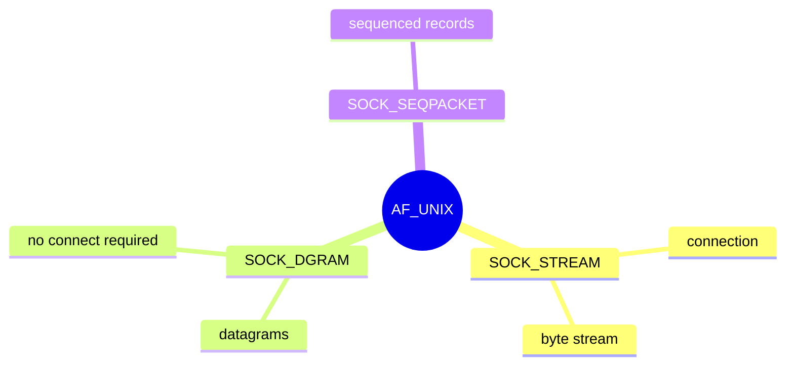
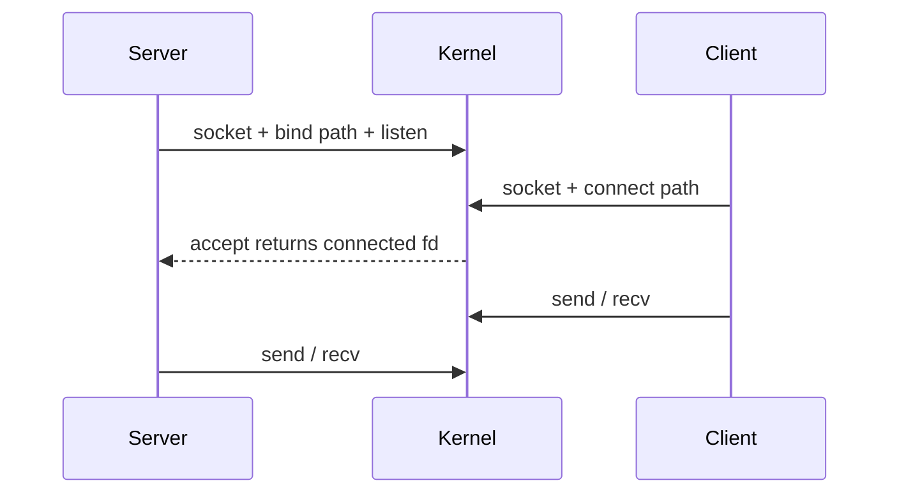

Not every socket goes to the network. **`AF_UNIX`** (aka local / Unix domain) connects processes on the same machine with the familiar socket API and lower overhead than TCP loopback.

## Flavors



## Connect path (stream)



## Pathnames vs abstract

- **Filesystem path** — e.g. `/run/app.sock`; permissions matter; leftover files need cleanup.
- **Abstract** — name starts with a NUL byte; no inode; visible in `/proc/net/unix`.

## Source landmarks

| Piece | Where |
| --- | --- |
| Core | `net/unix/` |
| Man | `man 7 unix` |
| Related | pipes, `socketpair(2)` |

## Lab — See local sockets

<div class="lab">

### Lab — List AF_UNIX endpoints

```bash
# Who is listening locally?
ss -xln | head -20
# Or classic:
cat /proc/net/unix | head -15
```

**Expect:** paths under `/run` or `@abstract` names, with inode / ref columns.

</div>

## Keep reading

- [Sockets and the networking stack](/linternals/blog/sockets-and-the-networking-stack/)
- [Syscalls: crossing the boundary](/linternals/blog/syscalls-crossing-the-boundary/)
- [man 7 unix](https://man7.org/linux/man-pages/man7/unix.7.html)
