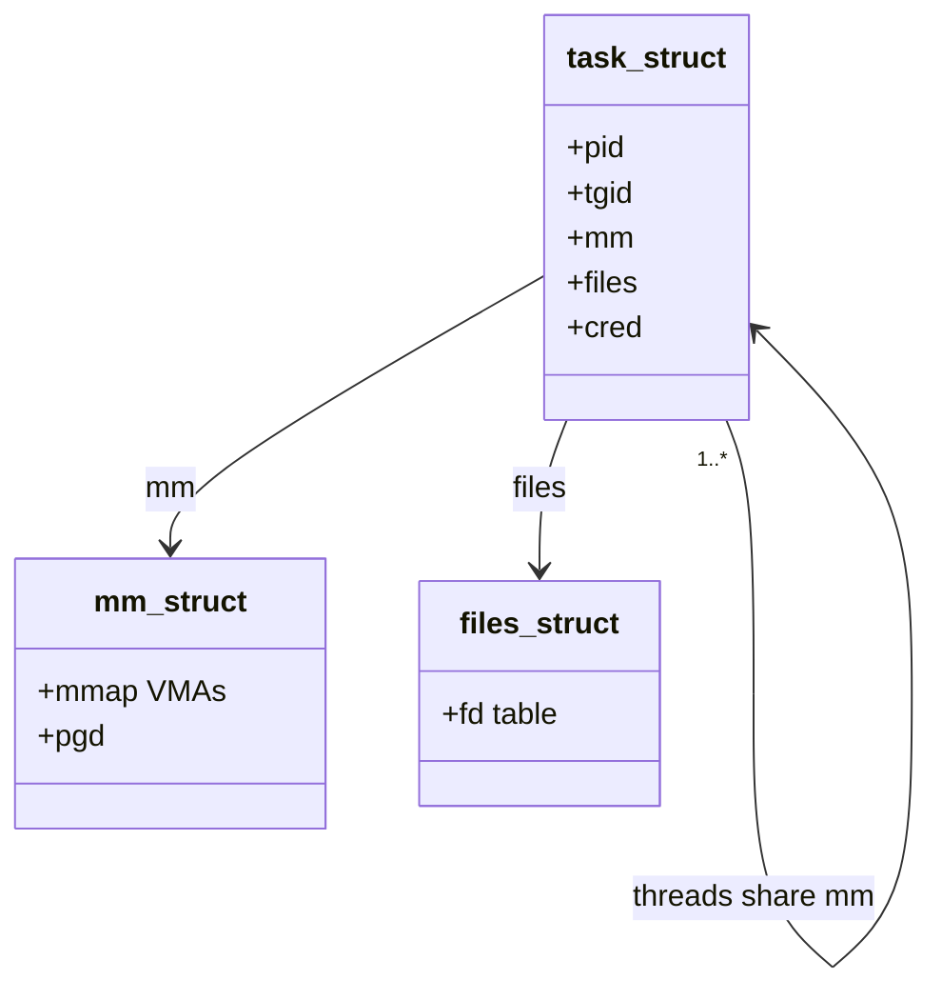
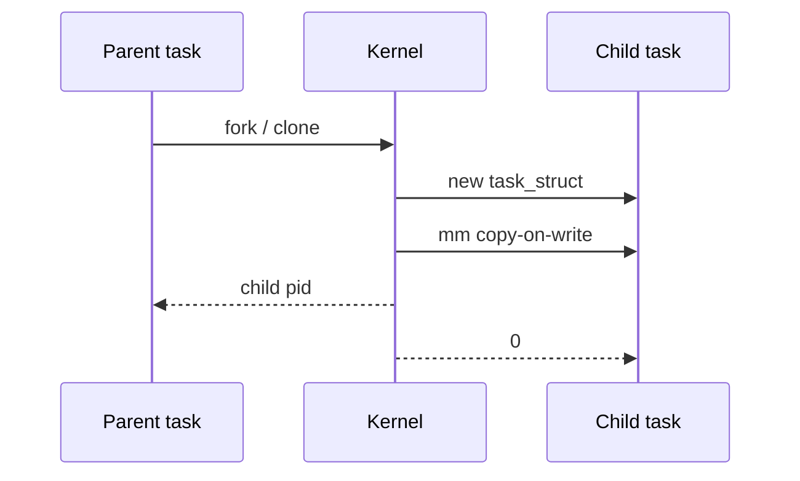

In userspace we say “process.” In the kernel, the central object is usually a `task_struct`. Understanding that struct is the fastest way into scheduling, signals, and credentials.

## Process vs thread (kernel view)

Linux implements threads as tasks that share some resources (address space, file table, …). The `clone` flags decide what is shared.



## What fork sets in motion



A classic `fork()` creates a new task with a copied (copy-on-write) address space. `execve()` later replaces that address space with a new program image.

## Fields worth knowing first

When you open `include/linux/sched.h` (or the generated headers in a build tree), start with:

- **identity** — `pid`, `tgid`, namespaces
- **memory** — pointer to `mm_struct`
- **files** — `files_struct`
- **scheduling** — policy, nice, CFS/EEVDF entities
- **credentials** — `cred`

## Experiment

```bash
# See threads of a process
ps -T -p $$

# Create a child and observe PIDs
bash -c 'echo parent=$$; bash -c "echo child=\$\$"'
```

<div class="lab">

### Lab — Process identity

**Goal:** See PID vs TID and parent/child relationships.

1. Print shell identity:
   ```bash
   echo "pid=$$ ppid=$PPID"
   ps -T -p $$
   ```
2. Fork a child and compare PIDs:
   ```bash
   bash -c 'echo parent=$$; bash -c "echo child=\$\$ ppid=\$PPID"'
   ```
3. Peek at `/proc` for the shell:
   ```bash
   ls /proc/$$/task | head
   cat /proc/$$/status | grep -E '^(Name|State|PPid|Threads)'
   ```
**Expect:** one PID for the process, one or more TIDs under `task/`, and a sensible `PPid`.

</div>

## Keep reading

- [Scheduler: CFS and EEVDF](/linternals/blog/scheduler-cfs-and-eevdf/)
- Next: [Syscalls: crossing the boundary](/linternals/blog/syscalls-crossing-the-boundary/)
