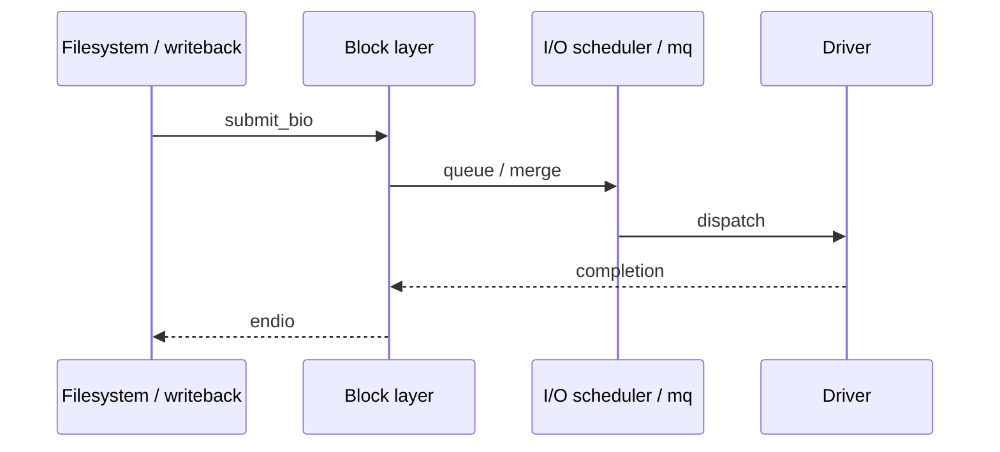
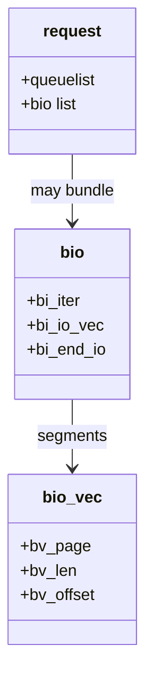

After the page cache decides data must come from or go to storage, the **block layer** packages work as `bio`s (and historically `struct request`s) for the device.

## Submit path



## Objects



## Mental model

1. Upper layers (filemap, FS writeback) build a **bio** describing pages + sector range.
2. `submit_bio` enters the block layer; multi-queue (blk-mq) paths dominate modern kernels.
3. The driver maps bios to hardware commands; completion callbacks clear pages / wake waiters.

## Source landmarks

| Piece | Where |
| --- | --- |
| bio helpers | `block/bio.c`, `include/linux/bio.h` |
| submit | `block/blk-core.c` (`submit_bio`) |
| mq | `block/blk-mq.c` |
| Docs | `Documentation/block/` |

## Lab — See block devices

<div class="lab">

### Lab — Name your block stack

1. List block devices and mounts:
   ```bash
   lsblk -f
   findmnt -t ext4,xfs,btrfs 2>/dev/null | head
   ```
2. Peek at queue settings for a disk (name may differ):
   ```bash
   ls /sys/block | head
   # cat /sys/block/sda/queue/scheduler 2>/dev/null
   ```
3. Optional I/O stats:
   ```bash
   grep -E 'sda|nvme' /proc/diskstats | head
   ```
**Expect:** a disk/partition list, a scheduler or `none`/[mq-deadline] style line, and nonzero stats if the disk is busy.

</div>

## Keep reading

- [Page cache and writeback](/linternals/blog/page-cache-and-writeback/)
- [VFS and the open path](/linternals/blog/vfs-and-the-open-path/)
- [kernel.org — block](https://docs.kernel.org/block/)
