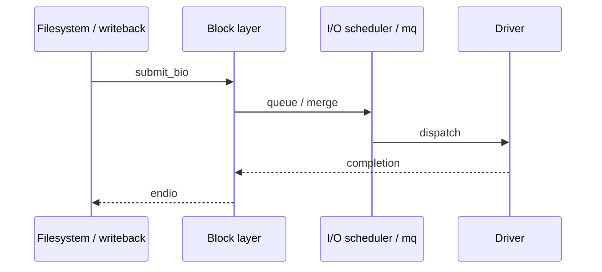

After the page cache decides data must come from or go to storage, the **block layer** packages work as `bio`s (and historically `struct request`s) for the device.

## Submit path



## Objects


## Mental model

1. Upper layers (filemap, FS writeback) build a **bio** describing pages + sector range.
2. `submit_bio` enters the block layer; multi-queue (blk-mq) paths dominate modern kernels.
3. The driver maps bios to hardware commands; completion callbacks clear pages / wake waiters.

## In the kernel

`struct bio` is in `include/linux/blk_types.h`. The fields that matter on a first read are `bi_bdev` (which device), `bi_opf` (read, write, flush, …), `bi_iter` (current sector and size), `bi_io_vec` (the page segments), and `bi_end_io` (who to call when the I/O finishes). A bio is not a request. Several bios can be merged into one `struct request` later, and a bio can also be split if it is too large for the queue.

The filesystem or the page cache allocates a bio with `bio_alloc` / `bio_alloc_bioset` in `block/bio.c`, fills the vectors, and calls `submit_bio` in `block/blk-core.c`. `submit_bio` only accounts the bytes (`PGPGIN` / `PGPGOUT`) and the I/O priority, then calls `submit_bio_noacct`. That function may sleep (`might_sleep()`), rejects writes to a read-only device, remaps partition offsets onto the whole disk, and checks that the bio fits the queue limits. The actual handoff is `__submit_bio`:

- Most disks take `blk_mq_submit_bio` in `block/blk-mq.c`. That builds or merges a request and lets the tag-based queue dispatch to the driver.
- A disk with `BD_HAS_SUBMIT_BIO` (stacked devices such as device-mapper) calls `disk->fops->submit_bio` instead of blk-mq directly.

Completion is the reverse: the driver calls `bio_endio`, which runs `bi_end_io`. That callback unlocks a page, wakes `submit_bio_wait`, or continues a split bio. The driver does not know it was ext4.

## Source landmarks

| Piece | Where |
| --- | --- |
| `struct bio` | `include/linux/blk_types.h` |
| Alloc | `block/bio.c` — `bio_alloc_bioset` |
| Submit | `block/blk-core.c` — `submit_bio`, `submit_bio_noacct`, `__submit_bio` |
| Multi-queue | `block/blk-mq.c` — `blk_mq_submit_bio` |
| Docs | `Documentation/block/` |

## Lab — See block devices

<div class="lab">

### Lab — Name your block stack

1. List block devices and mounts:
   ```bash
   lsblk -f
   findmnt -t ext4,xfs,btrfs 2>/dev/null | head
   ```
2. Peek at queue settings for a disk (name may differ):
   ```bash
   ls /sys/block | head
   # cat /sys/block/sda/queue/scheduler 2>/dev/null
   ```
3. Optional I/O stats:
   ```bash
   grep -E 'sda|nvme' /proc/diskstats | head
   ```
**Expect:** a disk/partition list, a scheduler or `none`/[mq-deadline] style line, and nonzero stats if the disk is busy.

</div>

<div class="lab">

### Lab — Find where a bio becomes a request

**Goal:** Separate the accounting wrapper from the queue.

1. Open `block/blk-core.c` and find `submit_bio`. It should call `submit_bio_noacct` and nothing that talks to hardware.
2. Find `__submit_bio`. One branch calls `blk_mq_submit_bio`; the other calls `disk->fops->submit_bio`.
3. Open `include/linux/blk_types.h` and find `bi_end_io` on `struct bio`.

**Expect:** `submit_bio` itself does not call the driver. The driver is reached from blk-mq or from the disk’s own `submit_bio` method.

</div>

## Keep reading

- [Page cache and writeback](/linternals/blog/page-cache-and-writeback/)
- [VFS and the open path](/linternals/blog/vfs-and-the-open-path/)
- [kernel.org — block](https://docs.kernel.org/block/)
