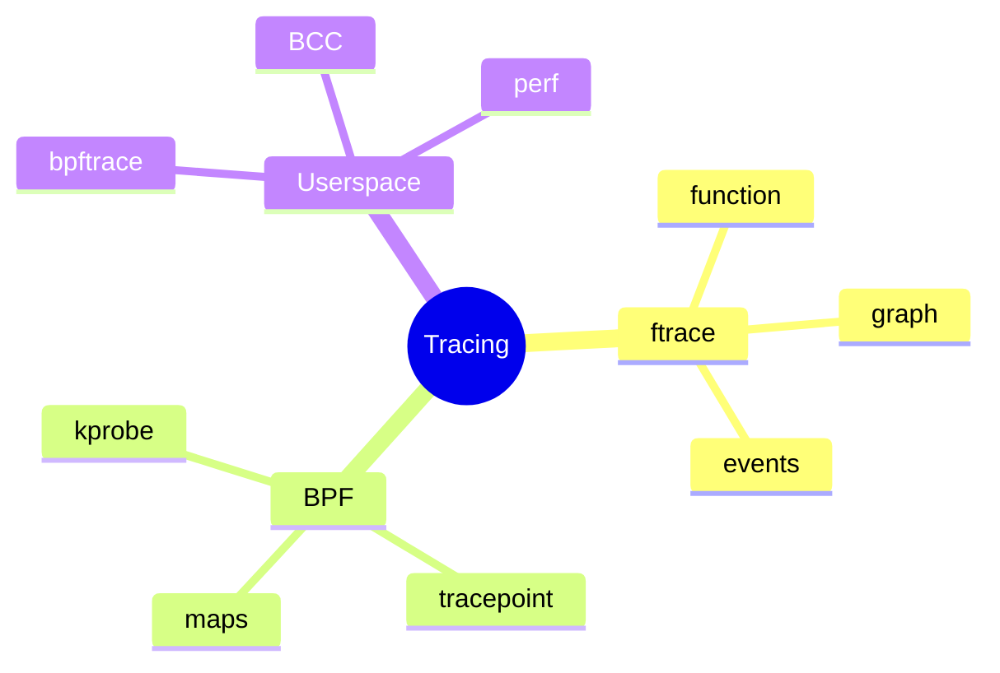
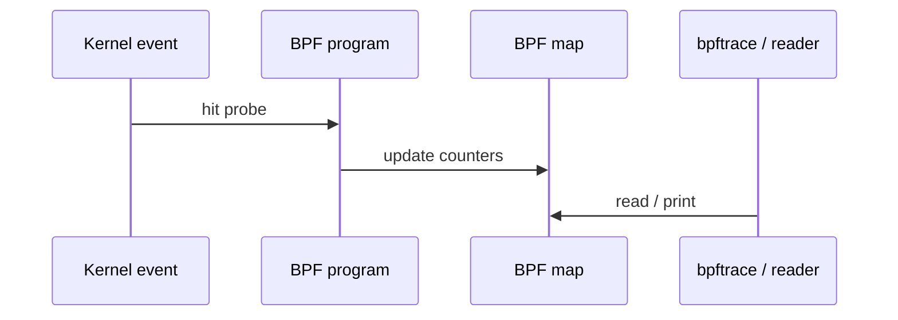

`/proc` answers static questions. **Tracing** answers “what just happened?” — ftrace for kernel function graphs; **BPF** for programmable, low-overhead probes.

## Tool map



## Probe path (mental model)



## Safe first steps

Prefer **tracepoints** and short `bpftrace` one-liners over invasive kprobes on production hosts. Always know how to stop the tracer.

## Source / docs

| Piece | Where |
| --- | --- |
| ftrace | `Documentation/trace/ftrace.rst` |
| BPF | `Documentation/bpf/` |
| Samples | bpftrace one-liners, BCC tools |

## Lab — One bpftrace or ftrace peek

<div class="lab">

### Lab — See syscalls or scheduler events

**If `bpftrace` is installed** (may need root):

```bash
sudo bpftrace -e 'tracepoint:raw_syscalls:sys_enter { @[comm] = count(); }' 
# Ctrl-C after a few seconds
```

**Else use ftrace availability:**

```bash
cat /sys/kernel/debug/tracing/available_tracers 2>/dev/null | head
# or
ls /sys/kernel/tracing 2>/dev/null | head
```

**Expect:** either a count table of processes making syscalls, or a tracers directory listing. Skip on locked-down hosts without privileges.

</div>

## Keep reading

- [procfs, sysfs, and seeing the kernel](/linternals/blog/procfs-and-observability/)
- [perf events intro](/linternals/blog/perf-events-intro/)
- [Syscalls: crossing the boundary](/linternals/blog/syscalls-crossing-the-boundary/)
- [kernel.org — BPF](https://docs.kernel.org/bpf/)
