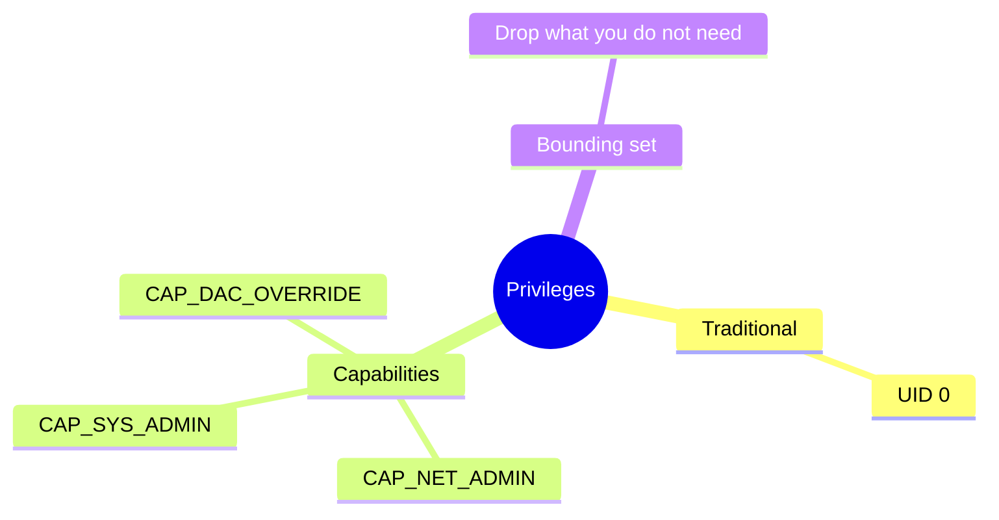
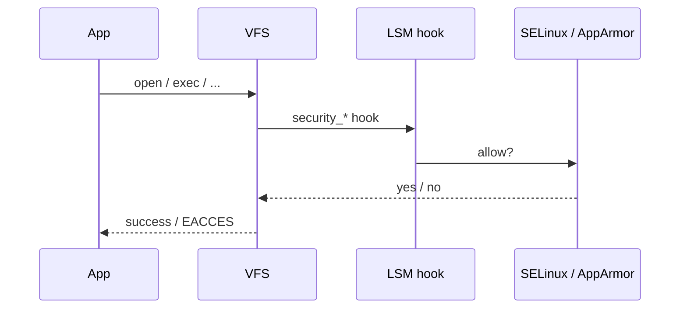

Classic Unix: UID 0 can do everything. Linux **capabilities** split that power; **LSM** (Linux Security Modules) adds policy hooks beyond DAC.

## Capability idea



## Where LSM sits



## Practical notes

- Containers often drop caps; see `capsh --print` / `/proc/$$/status` Cap* fields.
- LSM is stacked/chosen at boot; not every distro enables the same module.
- Capabilities ≠ LSM; both can deny you.

## Source landmarks

| Piece | Where |
| --- | --- |
| Caps | `kernel/capability.c`, `include/linux/capability.h` |
| LSM | `security/` , `security/security.c` |
| Man | `man 7 capabilities` |

## Lab — Read your caps

<div class="lab">

### Lab — Capability bits

```bash
grep -E '^Cap(Inh|Prm|Eff|Bnd|Amb)' /proc/$$/status
# Friendly decode if available:
capsh --decode=$(grep CapEff /proc/$$/status | awk '{print $2}') 2>/dev/null || true
# LSM:
cat /sys/kernel/security/lsm 2>/dev/null
```

**Expect:** hex capability masks; an LSM list such as `capability,landlock,selinux` (varies).

</div>

## Keep reading

- [Namespaces and cgroups](/linternals/blog/namespaces-and-cgroups/)
- [seccomp-BPF intro](/linternals/blog/seccomp-bpf-intro/)
- [Syscalls: crossing the boundary](/linternals/blog/syscalls-crossing-the-boundary/)
- [man 7 capabilities](https://man7.org/linux/man-pages/man7/capabilities.7.html)
