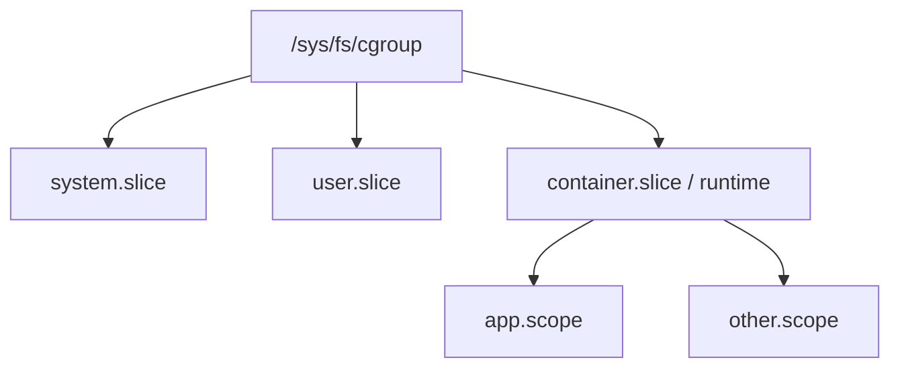
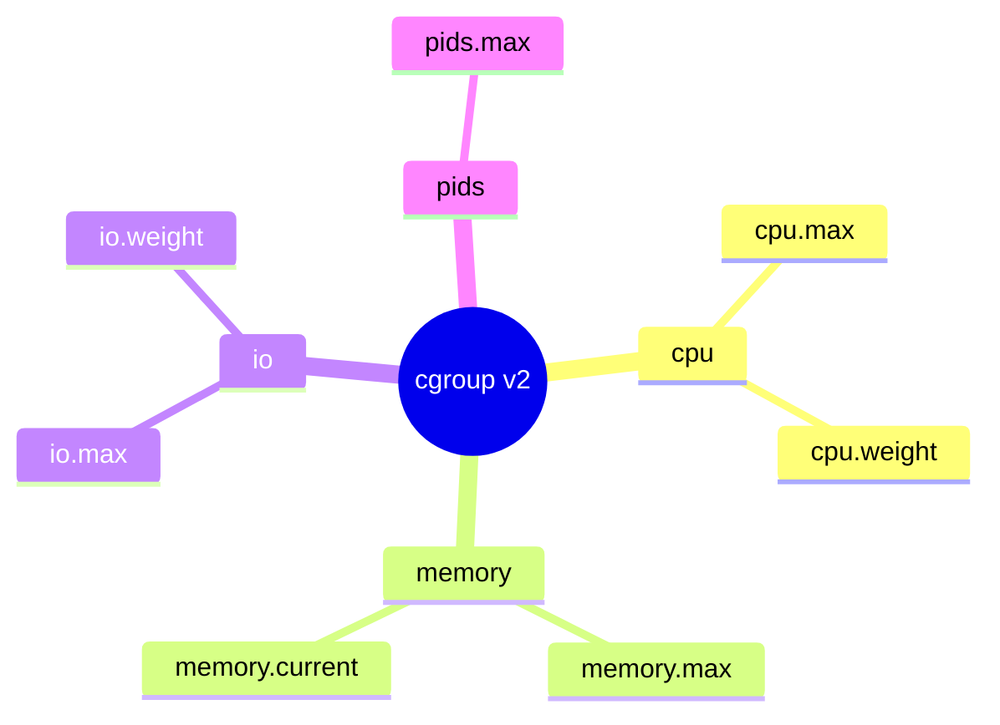

**cgroup v2** is a single hierarchy. Controllers plug into directories under `/sys/fs/cgroup`; writing interface files applies limits to a process tree.

## Hierarchy sketch



## Controllers you will meet



| File (examples) | Meaning |
| --- | --- |
| `cgroup.procs` | PIDs in this cgroup |
| `memory.current` / `memory.max` | Usage / hard cap |
| `cpu.max` | Quota / period |
| `pids.max` | Fork bomb brake |

Exact files depend on enabled controllers (`cgroup.controllers`).

## Source landmarks

| Piece | Where |
| --- | --- |
| Core | `kernel/cgroup/` |
| Memory | `mm/memcontrol.c` |
| Docs | `Documentation/admin-guide/cgroup-v2.rst` |

## Lab — Read your cgroup

<div class="lab">

### Lab — Where am I?

```bash
# v2 path for this shell (format varies slightly)
cat /proc/$$/cgroup
# If on a unified hierarchy:
CG=$(awk -F: '$1=="0"{print $3}' /proc/$$/cgroup)
echo "cgroup path: $CG"
ls /sys/fs/cgroup$CG 2>/dev/null | head -20
```

**Expect:** a path under `/sys/fs/cgroup` and controller files like `memory.current` when available.

</div>

## Keep reading

- [Namespaces and cgroups](/linternals/blog/namespaces-and-cgroups/)
- [PID namespaces (deep)](/linternals/blog/pid-namespaces-deep/)
- [Memory reclaim and OOM](/linternals/blog/memory-reclaim-and-oom/)
