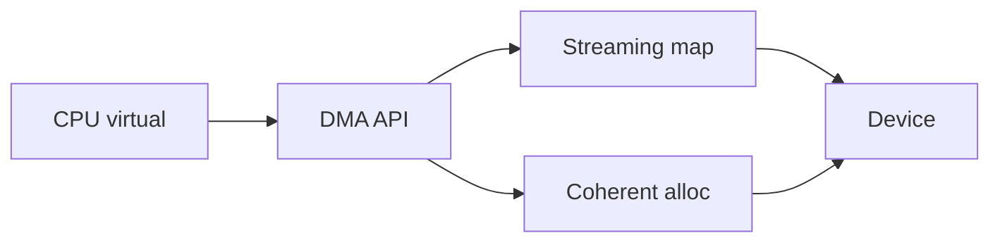
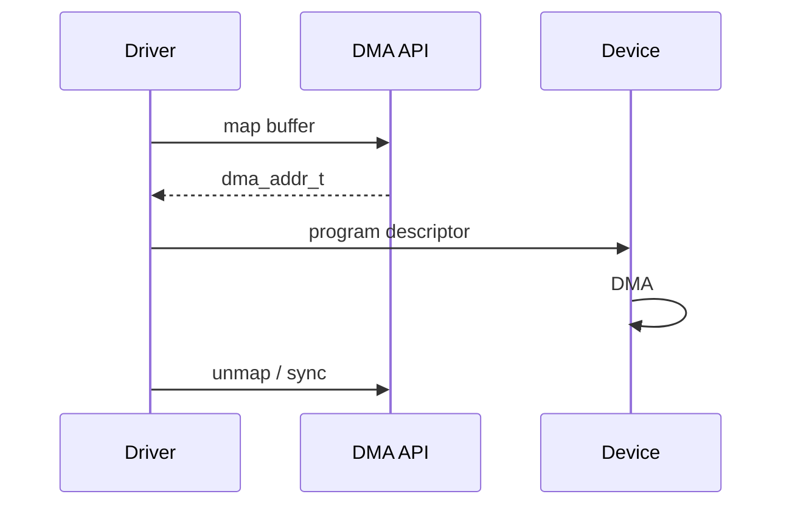

Devices DMA using **bus addresses**, not kernel virtual pointers. The **DMA API** (and often an **IOMMU**) translates and syncs caches so NIC/disk/GPU engines see consistent memory.

## Mapping kinds



| API style | Use |
| --- | --- |
| `dma_alloc_coherent` | Long-lived descriptors, cache-coherent |
| `dma_map_single` / `sg` | Transient TX/RX buffers |
| sync calls | Ownership handoff CPU ↔ device |

## Mental model



IOMMU presence changes address widths and isolation; always use the API, not virt_to_phys hacks, in portable drivers.

## Source landmarks

| Piece | Where |
| --- | --- |
| Docs | `Documentation/core-api/dma-api.rst` |
| Core | `kernel/dma/` |
| Related | [Kernel modules and the device model](/linternals/blog/kernel-modules-and-device-model/) |

## Lab — IOMMU / DMA notes

<div class="lab">

### Lab — Kernel DMA messages

```bash
dmesg -T 2>/dev/null | grep -iE 'iommu|dma' | tail -15 || true
ls /sys/class/iommu 2>/dev/null | head || echo "no iommu class (common on some VMs)"
```

**Expect:** IOMMU init lines on many bare-metal boxes; quieter output in simple VMs.

</div>

## Keep reading

- [Kernel modules and the device model](/linternals/blog/kernel-modules-and-device-model/)
- [Block layer and bio](/linternals/blog/block-layer-and-bio/)
- [NAPI and softnet](/linternals/blog/napi-and-softnet/)
