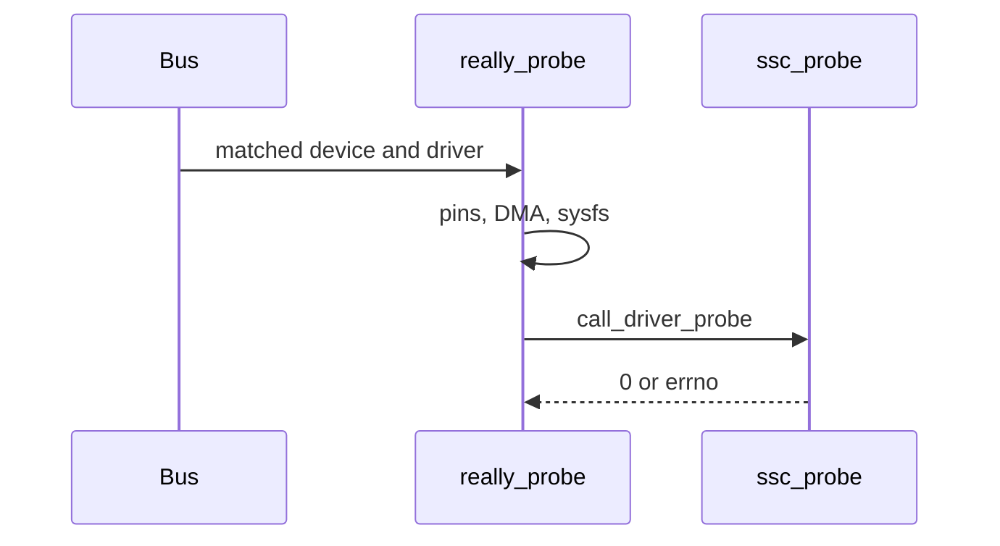

[Kernel modules and the device model](/linternals/blog/kernel-modules-and-device-model/) says a bus matches a device to a driver and then calls `probe`. This note follows that call in Linux 7.2.11, then reads one probe body so the steps are concrete.

## Two layers

`really_probe` in `drivers/base/dd.c` is the generic function. It refuses to run while `defer_all_probes` is set, checks that suppliers are ready (`device_links_check_suppliers`), and bails if the device already has devres resources. Then it `device_set_driver`s, binds pinctrl, lets the bus `dma_configure`, and adds the driver sysfs link. Only after that does it call `call_driver_probe`.

`call_driver_probe` prefers `dev->bus->probe` and otherwise calls `drv->probe`. A return of `0` means the device is claimed. `-EPROBE_DEFER` means “try again later” (a clock or regulator is not ready). `-ENODEV` and `-ENXIO` mean this driver rejects the match. Anything else is logged as a real failure. On failure, `really_probe` unbinds the driver it just attached.

## One body: Atmel SSC

`ssc_probe` in `drivers/misc/atmel-ssc.c` is a platform driver for a small Atmel serial controller. `module_platform_driver(ssc_driver)` registers it; `ssc_driver.probe` points at `ssc_probe`. You do not need the hardware. The shape is what most platform probes look like.

1. `devm_kzalloc` allocates the driver's private `struct ssc_device`. Failure returns `-ENOMEM`. Managed allocations are freed if probe fails or the device is removed.
2. `atmel_ssc_get_driver_data` rejects an unknown device with `-ENODEV`.
3. `devm_platform_get_and_ioremap_resource(pdev, 0, &regs)` maps MMIO resource 0 and records the physical start in `ssc->phybase`.
4. `devm_clk_get(..., "pclk")` looks up the peripheral clock. Missing clock returns `-ENXIO`. The probe then enables the clock, writes the interrupt-disable register, and disables the clock again. That is setup, not a request handler.
5. `platform_get_irq(pdev, 0)` takes the first IRQ. A negative return aborts the probe.
6. The device is linked onto a global list under `user_lock`, `platform_set_drvdata` publishes `ssc`, and the function returns `0`.

`ssc_remove` is the reverse of the list and the audio hook. The `devm_*` resources go away with the device, so remove does not `iounmap` or `kfree` them by hand.

This is one driver. The bind path in `dd.c` is the part that applies to USB, PCI, and platform devices alike.

## Source landmarks

| Piece | Where in 7.2.11 |
| --- | --- |
| Bind | `drivers/base/dd.c` — `really_probe`, `call_driver_probe` |
| Example | `drivers/misc/atmel-ssc.c` — `ssc_probe`, `ssc_driver` |
| Registration | `module_platform_driver(ssc_driver)` at the bottom of that file |

## Lab — Read the failure returns

### Lab — Who calls probe, and what −ENXIO means

**Goal:** Separate the driver core from the device-specific body.

1. Open `drivers/base/dd.c` and find `call_driver_probe`. Note the `-EPROBE_DEFER` case versus the `dev_err` default.
2. Find `really_probe` and the call to `call_driver_probe`. Confirm `device_set_driver` happens first.
3. Open `drivers/misc/atmel-ssc.c` and find `ssc_probe`. List the three early returns: `-ENOMEM`, `-ENODEV`, and `-ENXIO`.

**Expect:** `ssc_probe` is not invoked by name from `dd.c`. The core calls `drv->probe`. `-ENXIO` in this file means the `pclk` lookup failed, not that MMIO was missing.

## Keep reading

- [Kernel modules and the device model](/linternals/blog/kernel-modules-and-device-model/)
- [DMA API sketch](/linternals/blog/dma-api-sketch/)
- [kernel.org — driver model](https://docs.kernel.org/driver-api/driver-model/)
