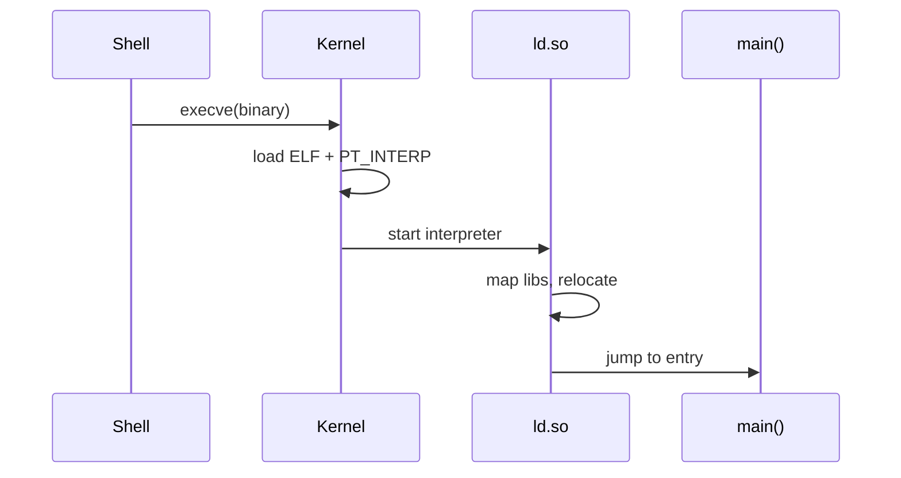
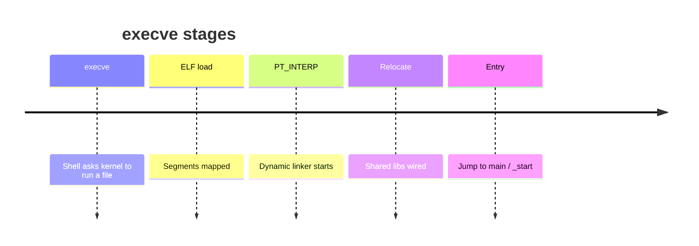

Starting a program is mostly **mapping bytes** and **fixing up symbols**. The kernel loads the ELF according to its program headers; the userspace dynamic linker (`ld.so`) maps shared libraries and applies relocations before jumping to the real entry point.

## Flow





## What the kernel does

On `execve`:

1. Permission and format checks (`binfmt_elf` for ELF).
2. Tear down the old address space (after `point of no return`).
3. Read ELF headers; map `PT_LOAD` segments with correct `r/w/x` via the same machinery behind `mmap` ([mmap and page faults](/linternals/blog/mmap-and-page-faults-deep/)).
4. If `PT_INTERP` is present (dynamically linked), map the interpreter (e.g. `/lib64/ld-linux-x86-64.so.2`) and set the initial user IP there.
5. Place `argv`, `envp`, and the **auxiliary vector** (`AT_*` entries: entry, phdrs, random, page size, …) on the new stack.
6. Return to userspace — first at `ld.so`, not at `main`.

Statically linked binaries skip the interpreter and enter the executable’s entry directly.

## What `ld.so` does

1. Parse the main binary’s dynamic section (`DT_NEEDED`, symbol tables, reloc tables).
2. Search library paths (`rpath` / `runpath`, `LD_LIBRARY_PATH`, defaults) and `mmap` each `.so`.
3. Apply relocations (fix GOT/PLT entries, relative relocs).
4. Run init functions (constructors).
5. Jump to the executable’s entry (`_start` → `__libc_start_main` → `main`).

Lazy PLT binding may resolve some symbols on first call — great for startup cost, surprising when debugging with `LD_DEBUG`.

## How this shows up in `/proc`

After exec, `maps` shows the executable, `[heap]`, stack, `ld.so`, libc, and other libraries — each an ELF mapping with relative offsets. That is why crash addresses need the right build-id / base for symbolization.

## Source landmarks

| Piece | Where |
| --- | --- |
| Kernel ELF loader | `fs/binfmt_elf.c` |
| Auxv setup | arch + `fs/binfmt_elf.c` |
| Userspace | glibc/`musl` ldso sources |
| Tools | `readelf`, `objdump`, `ldd`, `file` |

## Lab — Inspect a binary

<div class="lab">

### Lab — Headers, interpreter, libs

```bash
file $(which ls)
readelf -l $(which ls) | head -40
ldd $(which ls)
# Auxv for the current shell:
tr '\0' '\n' < /proc/$$/auxv 2>/dev/null | head || (od -An -tx8 /proc/$$/auxv | head)
```

**Expect:** ELF class/arch from `file`; `PT_INTERP` and `PT_LOAD` in program headers; `ldd` listing libc and friends. Auxv is binary — `od`/`hexdump` is fine.

</div>

## Pitfalls

- **`LD_LIBRARY_PATH` surprises** — wrong `.so` versions; setuid binaries ignore it for safety.
- **Missing interpreter** — “No such file or directory” on exec often means the *dynamic linker path* is wrong, not the binary name.
- **PIE / ASLR** — bases move; never hardcode absolute addresses from one run.
- **Thinking the kernel links symbols** — it maps segments; relocation is almost entirely userspace for dynamic ELF.

## Keep reading

- [Virtual memory walkthrough](/linternals/blog/virtual-memory-walkthrough/)
- [mmap and page faults (deep)](/linternals/blog/mmap-and-page-faults-deep/)
- [Syscalls: crossing the boundary](/linternals/blog/syscalls-crossing-the-boundary/)
- [vDSO and vsyscall](/linternals/blog/vdso-and-vsyscall/)
