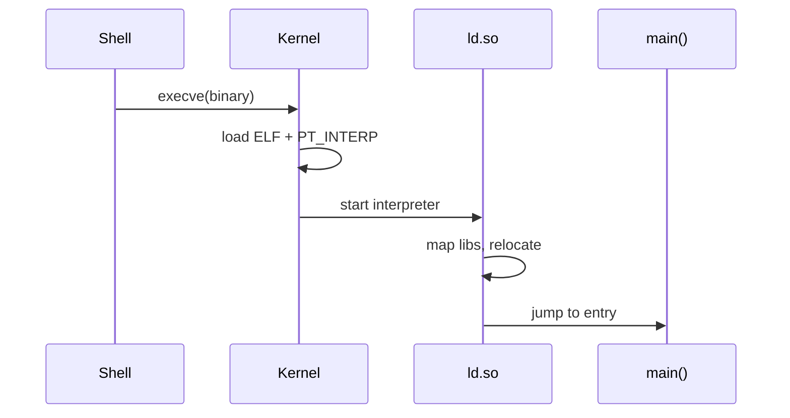

Starting a program is mostly mapping bytes and fixing up symbols — kernel loads the ELF; userspace dynamic linker finishes the job.

## Flow



## Useful commands

```bash
file $(which ls)
readelf -l $(which ls) | head
ldd $(which ls)
```

## Keep reading

- `fs/binfmt_elf.c` in the kernel tree
- Related: [Virtual memory walkthrough](/linternals/blog/virtual-memory-walkthrough/)
