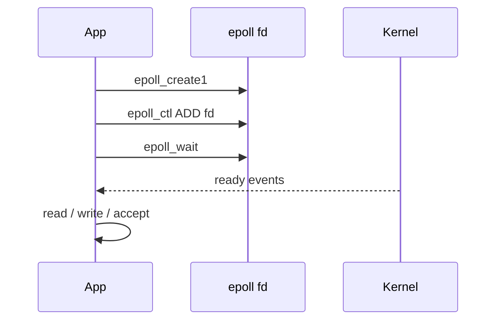
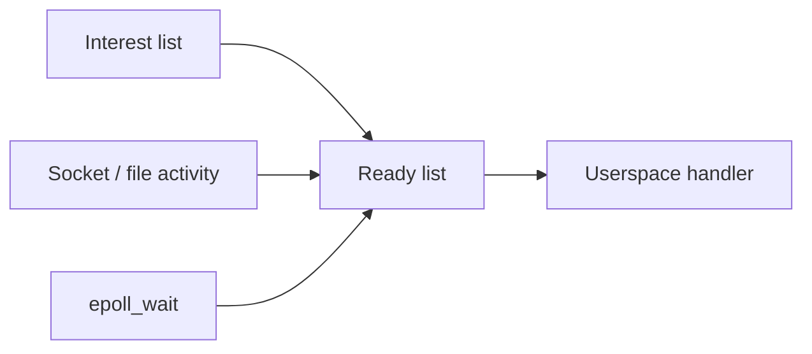

`select` and `poll` walk interest sets on every wait. **`epoll`** keeps interest in the kernel and returns only **ready** fds — the backbone of most Linux event loops.

## API shape



## Interest vs ready



- **`EPOLLIN` / `EPOLLOUT`** — readable / writable.
- **Level trigger (default)** — keeps reporting while the condition holds.
- **Edge trigger (`EPOLLET`)** — notify on transition; you must drain until `EAGAIN`.

## Why it scales

| Mechanism | Cost pattern |
| --- | --- |
| `select` / `poll` | Re-scan interest set each wait |
| `epoll` | O(ready) delivery after setup |
| Interest list | Stored in kernel on the epoll object |

## Source landmarks

| Piece | Where |
| --- | --- |
| Implementation | `fs/eventpoll.c` |
| Man pages | `epoll(7)`, `epoll_ctl(2)`, `epoll_wait(2)` |
| Related | `io_uring`, `poll`, signalfd, timerfd |

## Lab — Tiny epoll wait

<div class="lab">

### Lab — Watch stdin with epoll

```bash
python3 - <<'PY'
import select, sys
ep = select.epoll()
ep.register(sys.stdin.fileno(), select.EPOLLIN)
print("type a line, then Enter (Ctrl+D to end)")
while True:
    for fd, ev in ep.poll(timeout=5.0):
        line = sys.stdin.readline()
        if not line:
            raise SystemExit
        print("ready:", repr(line))
PY
```

**Expect:** `epoll_wait` (via `epoll.poll`) returns when stdin has data; idle waits time out.

</div>

## Keep reading

- [Syscalls: crossing the boundary](/linternals/blog/syscalls-crossing-the-boundary/)
- [io_uring intro](/linternals/blog/io-uring-intro/)
- [Sockets and the networking stack](/linternals/blog/sockets-and-the-networking-stack/)
---
