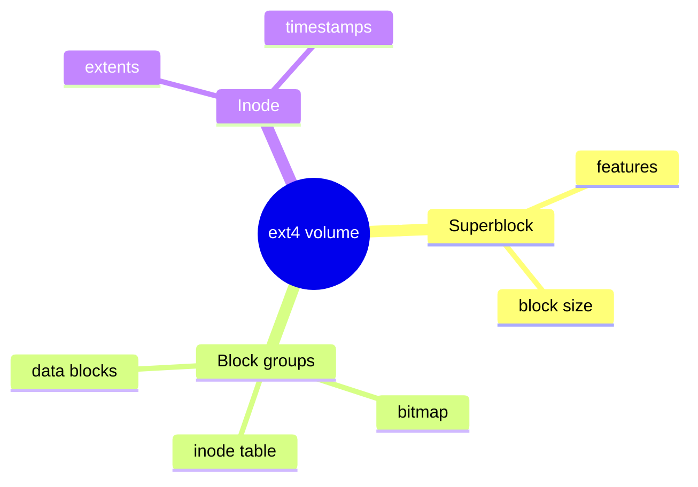
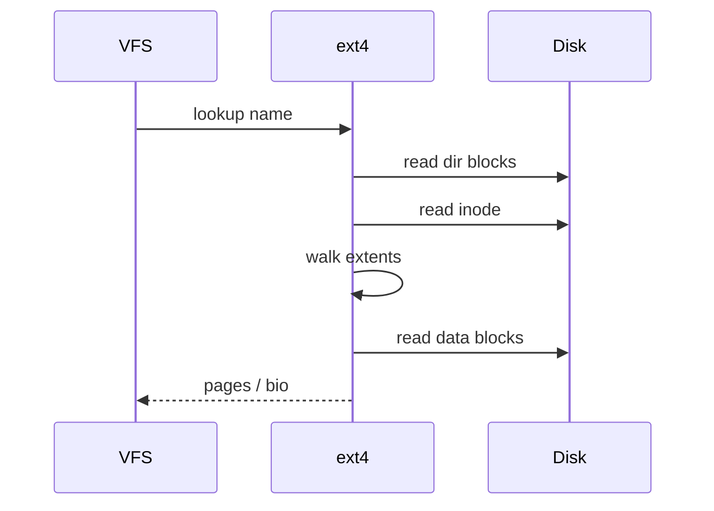

VFS is generic. **ext4** is a concrete on-disk format: block groups, inodes, and extent trees mapping file offsets to blocks.

## Layout sketch



## Read a file (disk view)



## Vocabulary

- **Superblock** — filesystem-wide metadata (often mirrored).
- **Block group** — bitmaps + inode table + data.
- **Inode** — per-file metadata; large files use **extents** instead of block maps.
- **Journal** — ordered/metadata journaling for crash consistency (high level).

## Source landmarks

| Piece | Where |
| --- | --- |
| Driver | `fs/ext4/` |
| On-disk structs | `fs/ext4/ext4.h` |
| Docs | `Documentation/filesystems/ext4/` |

## Lab — Ask the FS

<div class="lab">

### Lab — Identify ext4 features

```bash
findmnt -t ext4 | head
# For a mounted ext4 (device path from findmnt/lsblk):
# sudo tune2fs -l /dev/sdXN | grep -E 'Filesystem features|Inode count|Block size'
df -T . | head
```

**Expect:** `ext4` in the type column when applicable; `tune2fs` shows features like `extent`, `has_journal` (needs root + device).

</div>

## Keep reading

- [VFS and the open path](/linternals/blog/vfs-and-the-open-path/)
- [Block layer and bio](/linternals/blog/block-layer-and-bio/)
- [Page cache and writeback](/linternals/blog/page-cache-and-writeback/)
