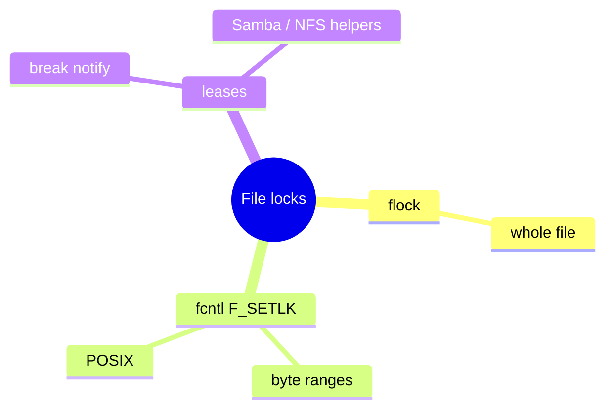
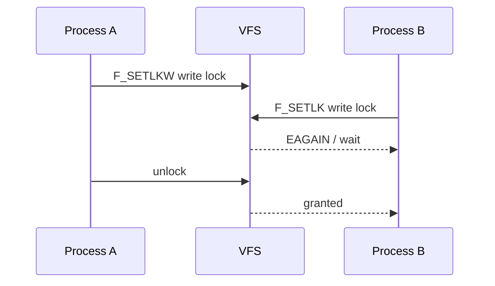

Processes coordinate on files with **advisory locks**. The kernel tracks them; cooperating programs honor them — non-cooperating writers can still ignore advisory mode.

## Flavors





## Details that bite

| Topic | Note |
| --- | --- |
| Advisory | Mandatory locking is rare / discouraged |
| Inheritance | POSIX locks associated with open file description quirks |
| NFS | Server/client semantics differ; test your stack |
| `/proc/locks` | Global view of held locks |

## Source landmarks

| Piece | Where |
| --- | --- |
| Core | `fs/locks.c` |
| Man | `fcntl(2)`, `flock(2)` |
| Proc | `/proc/locks` |

## Lab — List locks

<div class="lab">

### Lab — Read /proc/locks

```bash
head -20 /proc/locks
# Try a quick flock in another terminal if you want to see a line appear:
# flock /tmp/locktest sleep 30
```

**Expect:** possibly empty on a quiet system; lines appear while `flock` holders are alive.

</div>

## Keep reading

- [VFS and the open path](/linternals/blog/vfs-and-the-open-path/)
- [Locks: spinlocks, mutexes, RCU](/linternals/blog/locks-spinlocks-mutexes-rcu/)
- [Futexes: userspace to kernel](/linternals/blog/futexes-userspace-to-kernel/)
