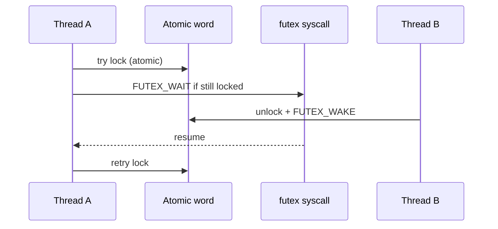
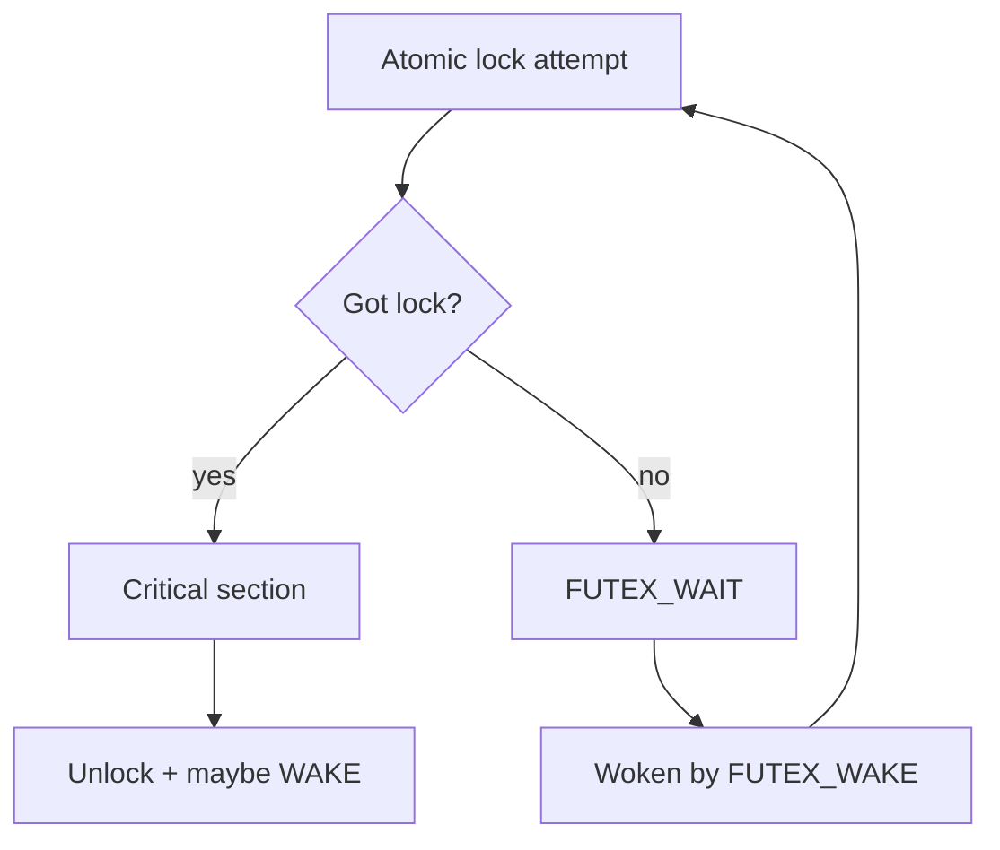

pthread mutexes and many language locks use a **futex** (fast userspace mutex): atomic ops in userspace when uncontended; only the slow path enters the kernel.

## Contended path



## Wait or return?



## Why internals people care

- Explains why `strace` shows `futex` under contended apps.
- Kernel side lives in `kernel/futex/` (wait queues keyed by address).
- Wrong wake/wait pairing → hangs that look like “mutex bugs.”

## Source landmarks

| Piece | Where |
| --- | --- |
| Syscall | `kernel/futex/` |
| Man page | `man 2 futex` |
| Userspace | glibc nptl / musl mutex |

## Lab — Catch a futex

<div class="lab">

### Lab — Contended threads

1. Run a tiny contended Python lock (or use `pthread` if you prefer C):
   ```bash
   python3 - <<'PY'
   import threading, time
   lock = threading.Lock()
   def work():
       for _ in range(20000):
           with lock:
               pass
   ts = [threading.Thread(target=work) for _ in range(4)]
   [t.start() for t in ts]; [t.join() for t in ts]
   print('done')
   PY
   ```
2. Trace futex activity (may need to wrap the script):
   ```bash
   strace -f -e futex python3 -c 'import threading;l=threading.Lock();\
   exec("def w():\n for _ in range(5000):\n  l.acquire(); l.release()\n");\
   ts=[__import__("threading").Thread(target=w) for _ in range(4)];\
   [t.start() for t in ts]; [t.join() for t in ts]' 2>&1 | head -40
   ```
**Expect:** `FUTEX_WAIT` / `FUTEX_WAKE` lines when threads contend.

</div>

## Keep reading

- [Locks: spinlocks, mutexes, RCU](/linternals/blog/locks-spinlocks-mutexes-rcu/)
- [Syscalls: crossing the boundary](/linternals/blog/syscalls-crossing-the-boundary/)
- [man 2 futex](https://man7.org/linux/man-pages/man2/futex.2.html)
