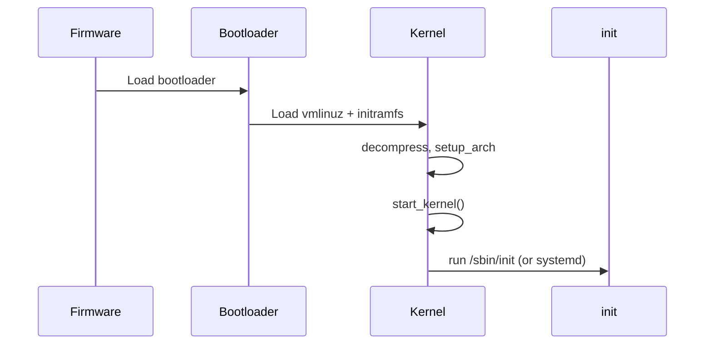

When you press the power button, a long chain of software runs before you ever see a shell. This note sketches that chain so you know which source files matter.

## The big picture



## Stages worth naming

1. **Firmware** — UEFI/BIOS finds a bootloader (GRUB, systemd-boot, etc.).
2. **Bootloader** — loads the kernel image and an optional initramfs into memory, then jumps to the kernel entry.
3. **Early kernel** — architecture-specific setup (`setup_arch`), memory bring-up, then `start_kernel()` in `init/main.c`.
4. **Rest of init** — subsystems register, root filesystem mounts, then the first userspace process starts.

## Source landmarks

| Area | Where to look |
| --- | --- |
| Generic init | `init/main.c` → `start_kernel` |
| Arch setup | `arch/*/kernel/setup.c` |
| Initramfs | `init/initramfs.c` |
| First process | `kernel_init` path toward userspace |

## Try this

On a running system:

```bash
# How did this kernel get started?
cat /proc/cmdline

# What was PID 1?
ps -p 1 -o pid,cmd
```

## Keep reading

- [kernel.org — Early userspace support](https://docs.kernel.org/filesystems/ramfs-rootfs-initramfs.html)
- Next: [Anatomy of a Linux process](/linternals/blog/anatomy-of-a-linux-process/)
