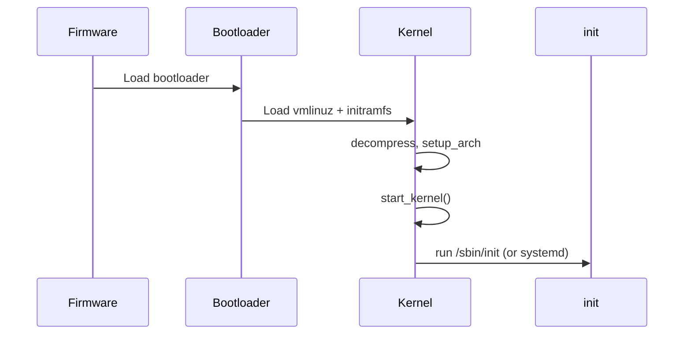
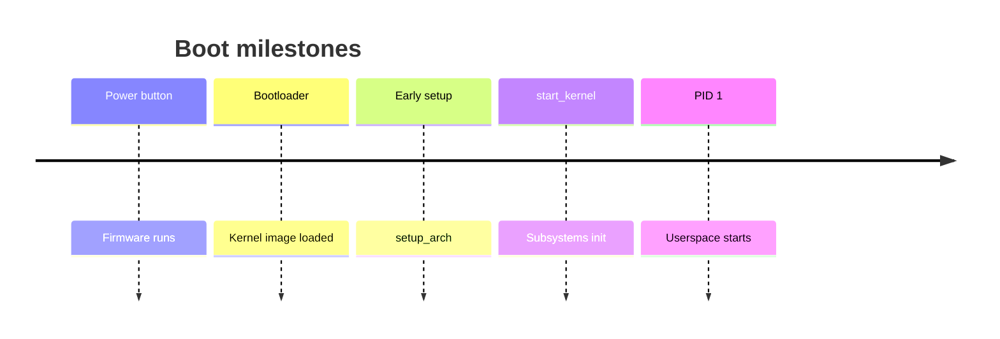

When you press the power button, a long chain of software runs before you ever see a shell. This note sketches that chain so you know which source files matter.

## The big picture





## Stages worth naming

1. **Firmware** — UEFI/BIOS finds a bootloader (GRUB, systemd-boot, etc.).
2. **Bootloader** — loads the kernel image and an optional initramfs into memory, then jumps to the kernel entry.
3. **Early kernel** — architecture-specific setup (`setup_arch`), memory bring-up, then `start_kernel()` in `init/main.c`.
4. **Rest of init** — subsystems register, root filesystem mounts, then the first userspace process starts.

## In the kernel

Open `init/main.c` and read three functions in this order. Do not try to memorize every call inside `start_kernel`; notice **what must exist before the next step is legal**.

**`start_kernel`** (around the `linux_banner` print) runs with interrupts still off. It calls `setup_arch`, parses the command line, then brings up the pieces later code assumes: `mm_core_init` (page allocator), `sched_init`, `rcu_init`, `early_irq_init` / `init_IRQ`, `softirq_init`, `timekeeping_init`. Interrupts are enabled only after that early chain. The function does not exec PID 1 itself. It ends by calling `rest_init`.

**`rest_init`** creates the two tasks the rest of boot depends on. The comment in the function is the whole story: init must be spawned first so it gets pid 1, but it must not run until `kthreadd` exists, or the first `kernel_thread` from init oopses. So the code does `user_mode_thread(kernel_init, ...)`, pins that task to the boot CPU, then `kernel_thread(kthreadd, ...)`, sets `system_state = SYSTEM_SCHEDULING`, `complete(&kthreadd_done)`, and drops the boot idle thread into `cpu_startup_entry`.

**`kernel_init`** waits on `kthreadd_done`, runs `kernel_init_freeable` (SMP bring-up, initcalls, root mount), frees `__init` memory, then tries to `exec` userspace. The fallback order is the ramdisk command, the `init=` command, `CONFIG_DEFAULT_INIT`, then `/sbin/init`, `/etc/init`, `/bin/init`, and `/bin/sh`. If all of those fail, it panics with “No working init found.”

On x86 the arch half of “early kernel” is `setup_arch` in `arch/x86/kernel/setup.c`, called from `start_kernel` before the allocator. Initramfs unpacking lives in `init/initramfs.c` and is reached from the freeable init path, not from the firmware.

## Source landmarks

| Area | Where to look |
| --- | --- |
| Generic init | `init/main.c` — `start_kernel`, `rest_init`, `kernel_init` |
| Arch setup | `arch/x86/kernel/setup.c` — `setup_arch` |
| Initramfs | `init/initramfs.c` |
| First process | `kernel_init` → `run_init_process` / `try_to_run_init_process` |

## Try this

On a running system:

```bash
# How did this kernel get started?
cat /proc/cmdline

# What was PID 1?
ps -p 1 -o pid,cmd
```

<div class="lab">

### Lab — Boot evidence on your machine

**Goal:** Connect firmware/bootloader choices to what `/proc` reports.

1. Record cmdline and kernel version:
   ```bash
   uname -r
   cat /proc/cmdline
   ```
2. Identify PID 1 and how long the system has been up:
   ```bash
   ps -p 1 -o pid,cmd,etime
   ```
3. Optional: list initrd / UKI clues if present:
   ```bash
   ls /boot 2>/dev/null | head
   ```
**Expect:** a kernel version string, boot flags (e.g. `root=`, `quiet`), and PID 1 as `systemd` or `init`.

</div>

<div class="lab">

### Lab — Find the handoff in the tree

**Goal:** See pid 1 created before userspace exists.

1. Open `init/main.c` in a kernel tree.
2. Find `rest_init`. Confirm it calls `user_mode_thread(kernel_init, ...)` **before** `kernel_thread(kthreadd, ...)`.
3. Find `kernel_init` and the four `try_to_run_init_process` paths.

**Expect:** pid 1 is `kernel_init` in kernel mode until one of those `exec`s succeeds. The `/sbin/init` string is not where the task is born.

</div>

## Keep reading

- [kernel.org — Early userspace support](https://docs.kernel.org/filesystems/ramfs-rootfs-initramfs.html)
- Next: [Anatomy of a Linux process](/linternals/blog/anatomy-of-a-linux-process/)
