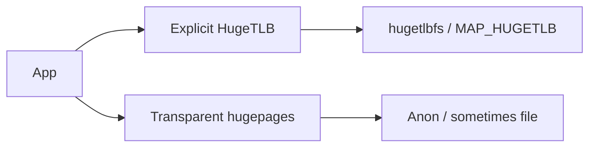
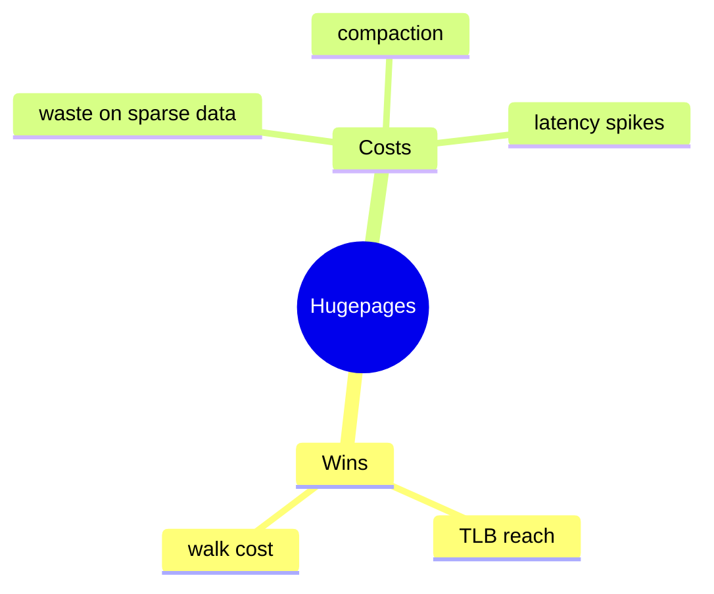

Base pages are usually 4K. **Hugepages** (2M / 1G on x86) shrink page-table depth and TLB pressure — at the cost of fragmentation and fault granularity.

## Two mechanisms



| Kind | Idea |
| --- | --- |
| HugeTLB | Reserved pools, `hugetlbfs`, explicit mmap |
| THP | Kernel may collapse/split anon pages transparently |
| Contiguous alloc | Related: CMA, gigantic pages |

## Tradeoffs



## In the kernel

`handle_mm_fault` in `mm/memory.c` branches early. If `is_vm_hugetlb_page(vma)`, it calls `hugetlb_fault` in `mm/hugetlb.c` and never takes the 4K PTE path. That function locks a per-hash mutex, allocates a huge PTE with `huge_pte_alloc`, and either maps an existing huge folio or asks `hugetlb_no_page` to pull one from the HugeTLB pool / hugetlbfs page cache. The pool is reserved ahead of time; a miss here is not a normal buddy allocation.

Transparent hugepages stay on the ordinary fault path. A missing PMD for an anonymous VMA reaches `do_huge_pmd_anonymous_page` in `mm/huge_memory.c`. If the VMA and address are suitable, it installs a PMD that points at a 2M folio (or the shared huge zero page on a read). If that fails, it returns `VM_FAULT_FALLBACK` and the kernel retries with base pages.

Collapse is separate from the fault. `khugepaged` scans eligible anonymous VMAs and calls `collapse_huge_page` in `mm/khugepaged.c` to replace a run of PTEs with one PMD. Userspace can also request a collapse through `madvise_collapse`. Split goes the other way when a hugepage must be broken for reclaim or a partial unmap.

HugeTLB is an explicit VMA type with its own fault function. THP is an optimization layered on the normal anonymous path.

## Source landmarks

| Piece | Where |
| --- | --- |
| Fault branch | `mm/memory.c` — `handle_mm_fault` → `hugetlb_fault` |
| HugeTLB fault | `mm/hugetlb.c` — `hugetlb_fault` |
| Anon THP fault | `mm/huge_memory.c` — `do_huge_pmd_anonymous_page` |
| Collapse | `mm/khugepaged.c` — `collapse_huge_page`, `madvise_collapse` |
| Sysfs | `/sys/kernel/mm/transparent_hugepage/` |

## Lab — THP knobs

<div class="lab">

### Lab — Read THP enabled mode

```bash
cat /sys/kernel/mm/transparent_hugepage/enabled 2>/dev/null || echo "no THP sysfs"
grep -i AnonHugePages /proc/meminfo
```

**Expect:** `[always] madvise never` style brackets; `AnonHugePages` may be zero on a quiet system.

</div>

<div class="lab">

### Lab — Two fault functions

**Goal:** Separate HugeTLB from THP in the source.

1. Open `handle_mm_fault` in `mm/memory.c`. Find the `is_vm_hugetlb_page` branch that calls `hugetlb_fault`.
2. Find `do_huge_pmd_anonymous_page` in `mm/huge_memory.c`. Note the `VM_FAULT_FALLBACK` exits.
3. Find `collapse_huge_page` in `mm/khugepaged.c`. That is background work, not the first-touch fault.

**Expect:** HugeTLB never shares the anonymous THP fault helper. Collapse is a third path.

</div>

## Keep reading

- [Page tables and the TLB](/linternals/blog/page-tables-and-tlb/)
- [Virtual memory walkthrough](/linternals/blog/virtual-memory-walkthrough/)
- [Memory reclaim and OOM](/linternals/blog/memory-reclaim-and-oom/)
