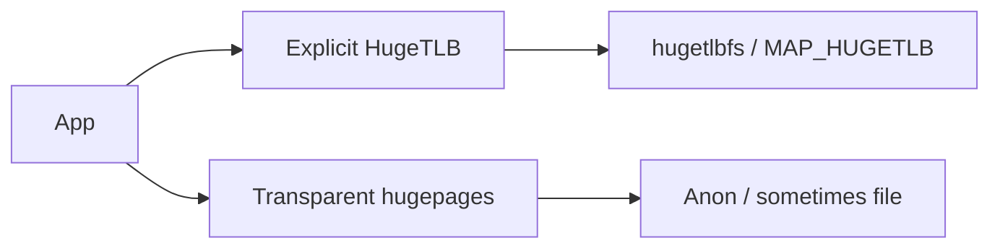
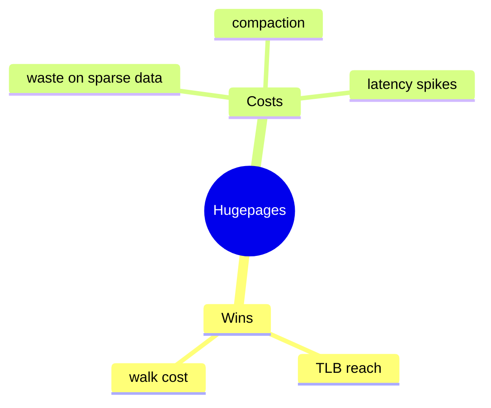

Base pages are usually 4K. **Hugepages** (2M / 1G on x86) shrink page-table depth and TLB pressure — at the cost of fragmentation and fault granularity.

## Two mechanisms



| Kind | Idea |
| --- | --- |
| HugeTLB | Reserved pools, `hugetlbfs`, explicit mmap |
| THP | Kernel may collapse/split anon pages transparently |
| Contiguous alloc | Related: CMA, gigantic pages |

## Tradeoffs



## Source landmarks

| Piece | Where |
| --- | --- |
| HugeTLB | `mm/hugetlb.c` |
| THP | `mm/khugepaged.c`, `mm/huge_memory.c` |
| Sysfs | `/sys/kernel/mm/transparent_hugepage/` |

## Lab — THP knobs

<div class="lab">

### Lab — Read THP enabled mode

```bash
cat /sys/kernel/mm/transparent_hugepage/enabled 2>/dev/null || echo "no THP sysfs"
grep -i AnonHugePages /proc/meminfo
```

**Expect:** `[always] madvise never` style brackets; `AnonHugePages` may be zero on a quiet system.

</div>

## Keep reading

- [Page tables and the TLB](/linternals/blog/page-tables-and-tlb/)
- [Virtual memory walkthrough](/linternals/blog/virtual-memory-walkthrough/)
- [Memory reclaim and OOM](/linternals/blog/memory-reclaim-and-oom/)
