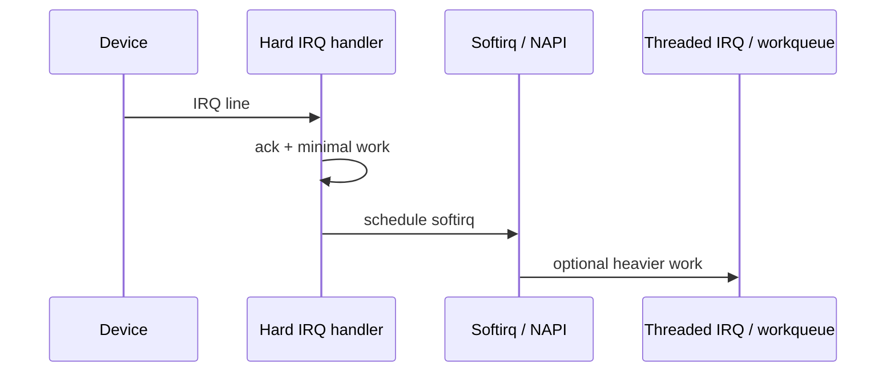

Devices interrupt the CPU when something needs attention: a packet arrived, a disk completed a command, a timer fired. The kernel splits that work into a tiny **top half** (hard IRQ) and deferred **bottom halves** (softirqs, tasklets historically, threaded IRQs, workqueues) so the system stays responsive.

## Split the work



**Hard IRQ context** runs with the interrupt (often) masked on that line / CPU. You must not sleep, you must not take mutexes, and you should do the minimum: acknowledge the device, grab or pointer-swap a buffer, schedule deferred work, return.

## Softirqs

**Softirqs** are a fixed set of deferred types (network RX/TX, block, timers, RCU, …) that run after hard IRQs in a still-atomic-ish context — still no sleeping. Networking’s **NAPI** poll loop is the classic softirq consumer: drain a budget of packets, then re-arm interrupts ([NAPI and softnet](/linternals/blog/napi-and-softnet/)).

If softirq work keeps flooding a CPU, you will see rising counts in `/proc/softirqs` and latency for normal tasks on that CPU. `ksoftirqd` threads exist to carry softirq load when it would otherwise starve userspace.

## Threaded IRQs and workqueues

Modern drivers often request a **threaded IRQ**: hard half wakes a dedicated kernel thread that can sleep, take mutexes, and talk to slower buses. **Workqueues** are the general “run this function later in process context” tool ([Workqueues and kthreads](/linternals/blog/workqueues-and-kthreads/)).

| Mechanism | May sleep? | Typical use |
| --- | --- | --- |
| Hard IRQ | No | Ack device, schedule work |
| Softirq / NAPI | No | High-rate packet / block completion |
| Threaded IRQ | Yes | Most device drivers today |
| Workqueue | Yes | Deferred cleanup, I/O follow-up |

Legacy **tasklets** are softirq-based one-shot callbacks; new code prefers threaded IRQs or workqueues.

## How an IRQ gets to your driver

1. Hardware raises a line / MSI message.
2. Arch code + irqchip acknowledge and look up an IRQ descriptor.
3. The registered `irq_handler_t` (top half) runs.
4. Optional thread function runs in `IRQF_ONESHOT` style setups.
5. `/proc/interrupts` counts the event per CPU.

Shared IRQs (rare on modern MSI-X systems, still relevant on some platforms) mean handlers must check “was this mine?” before claiming the event.

## Source landmarks

| Piece | Where |
| --- | --- |
| IRQ core | `kernel/irq/` |
| Softirqs | `kernel/softirq.c` |
| Docs | `Documentation/core-api/genericirq.rst` |

## Lab — Inspect live

<div class="lab">

### Lab — IRQ and softirq counters

```bash
cat /proc/interrupts | head
cat /proc/softirqs
# Optional: watch which CPU is busy with NET_RX
# watch -n1 'head -5 /proc/softirqs'
```

**Expect:** device names next to IRQ numbers; softirq columns per CPU (`NET_RX`, `TIMER`, `RCU`, …). Wiggle the network and watch `NET_RX` move on a busy host.

</div>

## Pitfalls

- **Too much in hard IRQ** — latency spikes, locked-up feel under load.
- **Sleeping in softirq** — illegal; leads to BUG / scheduling while atomic.
- **Missing wake / NAPI complete** — stuck queues, no more packets until reset.
- **Affinity** — pinning IRQs and application threads poorly can leave one CPU hot ([SMP and CPU affinity](/linternals/blog/smp-and-cpu-affinity/)).

## Keep reading

- [Timers and timekeeping](/linternals/blog/timers-and-timekeeping/)
- [Workqueues and kthreads](/linternals/blog/workqueues-and-kthreads/)
- [NAPI and softnet](/linternals/blog/napi-and-softnet/)
- [Locks: spinlocks, mutexes, RCU](/linternals/blog/locks-spinlocks-mutexes-rcu/)
- [kernel.org — IRQ](https://docs.kernel.org/core-api/genericirq.html)
