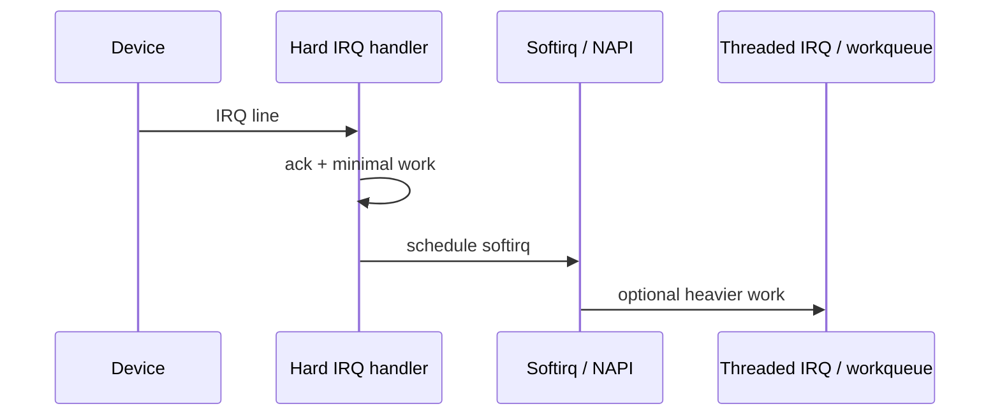

Devices interrupt the CPU. The top half acknowledges hardware quickly; deferred work runs later in a safer context.

## Split the work



## Why it matters

- Hard IRQ context: no sleeping, keep it tiny
- Softirqs / NAPI: batch packet processing
- Threaded IRQs & workqueues: can sleep, use locks normally

## Inspect live

```bash
cat /proc/interrupts | head
# softirq counters
cat /proc/softirqs
```

## Keep reading

- [Timers and timekeeping](/linternals/blog/timers-and-timekeeping/)
- [kernel.org — IRQ](https://docs.kernel.org/core-api/genericirq.html)
- Related: [Locks: spinlocks, mutexes, RCU](/linternals/blog/locks-spinlocks-mutexes-rcu/)
