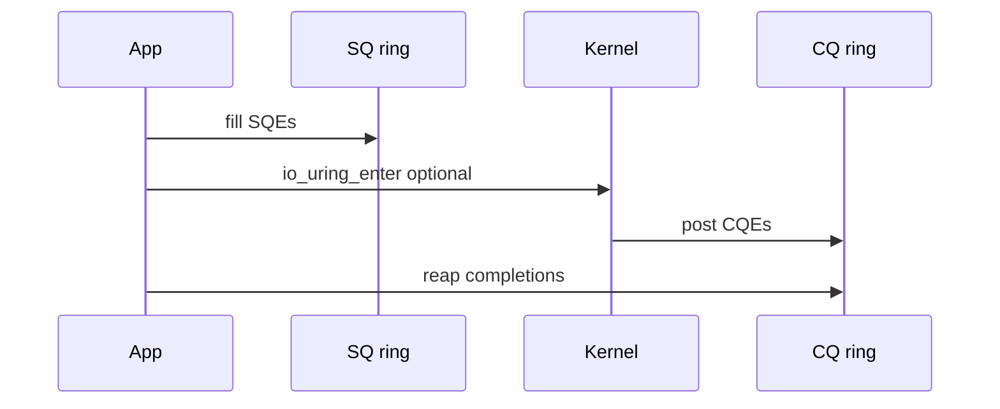

Classic I/O pays a **syscall per operation**. **`io_uring`** maps shared **submission** and **completion** rings so userspace can batch work and reap results with far fewer crossings.

## Rings




## Pieces

| Name | Role |
| --- | --- |
| SQE | Submission queue entry — opcode, fd, buffers, flags |
| CQE | Completion queue entry — result, user_data |
| `io_uring_setup` | Create ring + map regions |
| `io_uring_enter` | Submit / wait (can be minimized with SQPOLL) |

Ops cover reads/writes, accepts, timeouts, and more — the surface grows with kernel version.

## When it helps

- Many small I/Os (storage or sockets) where syscall overhead dominates.
- Pipelines that can keep the ring full.
- Less magic for simple blocking scripts — `read`/`write` still win for clarity.

## Source landmarks

| Piece | Where |
| --- | --- |
| Core | `io_uring/` |
| UAPI | `include/uapi/linux/io_uring.h` |
| Lib | `liburing` (userspace helper) |
| Docs | `man 7 io_uring` |

## Lab — Feature probe

<div class="lab">

### Lab — Is io_uring available?

```bash
# Kernel config / presence (paths vary by distro)
zgrep -i IO_URING /proc/config.gz 2>/dev/null || true
ls /usr/include/linux/io_uring.h 2>/dev/null || true
# If liburing tools exist:
which io_uring_test 2>/dev/null || echo "install liburing-examples or build samples later"
```

**Expect:** config symbol or headers if your kernel/userspace supports io_uring.

</div>

## Keep reading

- [epoll and event loops](/linternals/blog/epoll-and-event-loops/)
- [VFS and the open path](/linternals/blog/vfs-and-the-open-path/)
- [Block layer and bio](/linternals/blog/block-layer-and-bio/)
---
