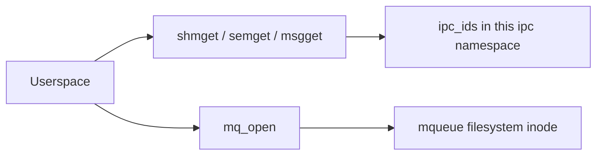

Processes on one machine can share memory, counters, and messages without a socket. Linux has two kernels of that idea in `ipc/`: **System V** objects addressed by an integer id, and **POSIX message queues** addressed by a pathname.

## Two APIs

System V is the older interface (`ipcs`, `shmget`, `semop`, `msgsnd`). POSIX mqueues look like files: you open a name, get an fd, and read or write messages. They do not share the System V id table.

## System V: one allocator, three object types

`ipc/util.c` builds the table. `ipc_init_ids` sets up an `ipc_ids`: a reader-writer semaphore, an rhashtable of keys, and an idr of live objects. `ipc_addid` inserts a `struct kern_ipc_perm` into that idr, stamps the caller's euid/egid, and fails with `-ENOSPC` when the namespace is at its limit. The comment on `ipc_addid` says the new entry is returned locked, and the caller must `ipc_rcu_putref` it on failure.

Each object type is a thin syscall layer over that table:

| Call | File | What the id refers to |
| --- | --- | --- |
| `shmget` / `shmat` | `ipc/shm.c` | A range of pages other tasks can map |
| `semget` / `semop` | `ipc/sem.c` | An array of counters and a wait queue |
| `msgget` / `msgsnd` / `msgrcv` | `ipc/msg.c` | A queue of typed messages |

`shmat` is the odd one: after `shmget` returns an id, `shmat` maps those pages into the caller's address space. The other two stay as kernel objects you operate on by id. Keys (`IPC_PRIVATE` or an `ftok` key) let unrelated processes find the same object; the id is only valid inside the current IPC namespace.

## POSIX mqueue: an open, not an id

`SYSCALL_DEFINE4(mq_open` in `ipc/mqueue.c` copies the optional `mq_attr` and calls `do_mq_open`. That function does not touch `ipc_ids`. It takes the mount `current->nsproxy->ipc_ns->mq_mnt`, creates or looks up a dentry, and `dentry_open`s it. `FD_ADD` publishes the fd. Sending and receiving then look like file operations on that inode, with the queue limits stored on the inode rather than in an idr.

So a strace of `mq_open` resembles `openat`. A strace of `shmget` does not.

## A namespace of ids

`copy_ipcs` in `ipc/namespace.c` is the `CLONE_NEWIPC` hook. Without the flag it returns the parent's `ipc_namespace`. With the flag it calls `create_ipc_ns`, which gets empty shm, sem, and msg id sets and its own mqueue mount. A container therefore cannot `shmget` an id that belongs to the host. This is the same idea as a pid namespace, applied to IPC objects. See [Namespaces and cgroups](/linternals/blog/namespaces-and-cgroups/).

## Source landmarks

| Piece | Where |
| --- | --- |
| Id table | `ipc/util.c` — `ipc_init_ids`, `ipc_addid` |
| Shared memory | `ipc/shm.c` — `shmget`, `shmat` |
| Semaphores | `ipc/sem.c` — `semget`, `semop` |
| Messages | `ipc/msg.c` — `msgget`, `msgsnd`, `msgrcv` |
| POSIX queues | `ipc/mqueue.c` — `mq_open`, `do_mq_open` |
| Namespace | `ipc/namespace.c` — `copy_ipcs` |

## Lab — Two lookups

### Lab — Id table versus mqueue mount

**Goal:** See that the two APIs do not meet in one function.

1. Open `ipc/util.c` and find `ipc_addid`. Note the `-ENOSPC` check against `ids->in_use`.
2. Open `ipc/mqueue.c` and find `do_mq_open`. Confirm it uses `ipc_ns->mq_mnt` and `FD_ADD`, not `ipc_addid`.
3. Open `ipc/namespace.c` and find `copy_ipcs`. The `CLONE_NEWIPC` test is the whole branch.

**Expect:** System V objects are numbers in an idr. A POSIX queue is a file on a per-namespace mount.

## Keep reading

- [AF_UNIX sockets](/linternals/blog/af-unix-sockets/)
- [Namespaces and cgroups](/linternals/blog/namespaces-and-cgroups/)
- [man 7 sysvipc](https://man7.org/linux/man-pages/man7/sysvipc.7.html)
- [man 7 mq_overview](https://man7.org/linux/man-pages/man7/mq_overview.7.html)
