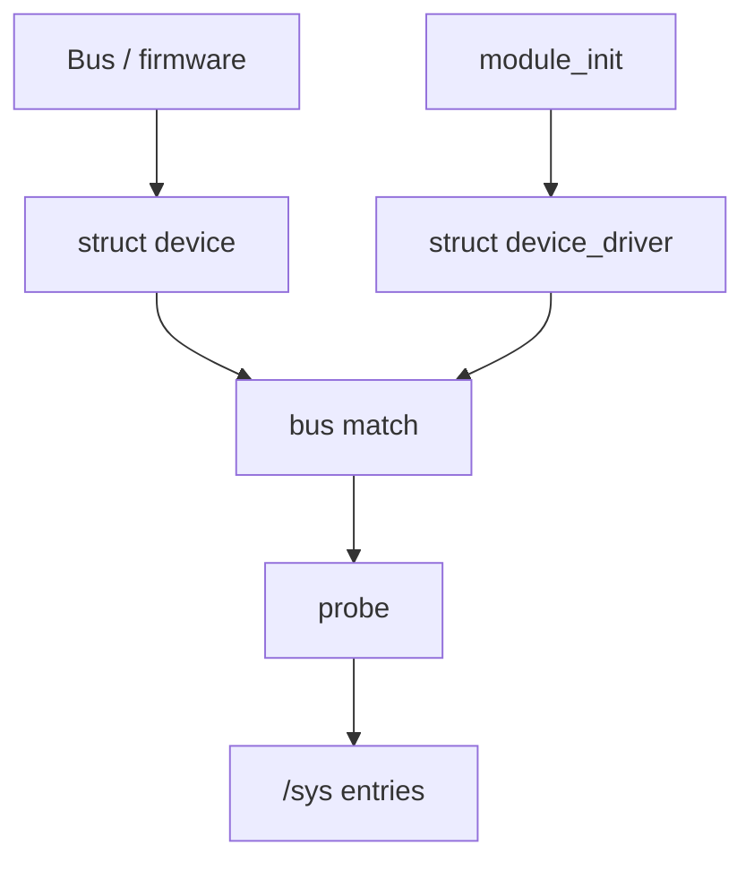

Most driver code can live in a **module**: loaded after boot, bound through the driver model, and visible under `/sys`. Built-in code is linked into `vmlinux`; modules are `.ko` files the kernel can load, unload, and (usually) hotplug against real hardware.

## Why modules exist

Shipping every driver in the main image would bloat memory and force a reboot for every tweak. Modules let distros ship a small core kernel plus optional drivers. When a USB stick appears, the bus code can `request_module` and the right `.ko` loads, then **probe** runs.

Tradeoff: module unload and live-patching are careful paths — references must drop to zero, and some subsystems refuse unload while in use.

## What a module is

| Piece | Role |
| --- | --- |
| `module_init` / `module_exit` | Entry and cleanup |
| `MODULE_LICENSE` / `MODULE_AUTHOR` | Metadata (`modinfo`) |
| Exported symbols | `EXPORT_SYMBOL` APIs other modules may call |
| Parameters | `module_param` → `/sys/module/<name>/parameters` |

`insmod` / `modprobe` ask the kernel to map the ELF, relocate it, run init, and register whatever drivers or filesystems the module provides. `modprobe` also resolves dependencies via `modules.dep`.

## The device model

Linux does not treat “a driver” as a lone function. It uses a **bus + device + driver** triangle:



1. **Firmware / enumeration** discovers hardware (PCI BARs, USB descriptors, DT / ACPI nodes) and registers a `struct device` on a bus.
2. A **driver** registers with that bus (`pci_register_driver`, platform, etc.).
3. The bus **match** callback decides compatibility (IDs, OF compatible strings, …).
4. On match, **`probe`** runs: claim resources, set up DMA/IRQs, create char/block/netdev nodes.
5. Sysfs mirrors the graph under `/sys/devices`, `/sys/bus`, `/sys/class`.

Unbind / remove paths reverse this: stop I/O, free IRQs, drop references.

## Sysfs as the userspace face

`/sys` is not a dump of random files — it is the device model exported as a filesystem. Useful habits:

- `/sys/bus/<bus>/devices` — what the bus sees
- `/sys/class/<class>` — functional view (net, block, graphics)
- `/sys/module/<name>` — refcnt, holders, parameters

When something “doesn’t probe,” compare **device present** vs **driver bound** (`driver` symlink under the device directory).

## Source landmarks

| Piece | Where |
| --- | --- |
| Module loader | `kernel/module/` |
| Driver core | `drivers/base/` |
| Sysfs | `fs/sysfs/` |
| Docs | `Documentation/driver-api/driver-model/` |

## Lab — Modules and buses

<div class="lab">

### Lab — See loadable code and the bus tree

```bash
lsmod | head
modinfo ext4 | head
ls /sys/bus
# Pick one device and see if a driver is bound:
ls /sys/bus/pci/devices 2>/dev/null | head -3
```

**Expect:** a table of modules with use counts; `modinfo` showing license/path/deps; bus names like `pci`, `usb`, `platform`. Bound devices usually have a `driver` symlink.

</div>

## Pitfalls

- **GPL-only exports** — proprietary modules cannot call some symbols; taint flags appear in oopses.
- **Probe vs open** — probe means “hardware claimed,” not “userspace already using it.”
- **Unload while busy** — `rmmod` fails with “in use”; force-unload is a last resort for debugging only.
- **Initcall order** — built-in drivers run at levels; modules run when loaded — ordering bugs show up as “device not ready yet.”

## Keep reading

- [DMA API sketch](/linternals/blog/dma-api-sketch/)
- [Interrupts, softirqs, and bottom halves](/linternals/blog/interrupts-softirqs-and-tasklets/)
- [kernel.org — driver model](https://docs.kernel.org/driver-api/driver-model/)
- Related: [Reading kernel source](/linternals/blog/reading-kernel-source/)
