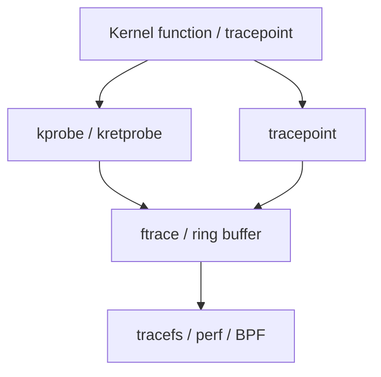

Before (and beside) BPF, Linux had **ftrace** and **kprobes**: plant a breakpoint or patch a call site, run a handler, record events into a ring buffer.

## Stack



## Interfaces

| Interface | Role |
| --- | --- |
| `tracefs` (`/sys/kernel/tracing`) | Enable events, read `trace_pipe` |
| kprobe events | Dynamic probes by symbol |
| `perf probe` | Helper around probes |
| BPF | Attach to same hook classes with verifier |

Careful on production: probes add overhead and wrong handlers can destabilize the machine.

## Source landmarks

| Piece | Where |
| --- | --- |
| ftrace | `kernel/trace/` |
| kprobes | `kernel/kprobes.c` |
| Docs | `Documentation/trace/` |

## Lab — List available tracers

<div class="lab">

### Lab — Peek tracefs

```bash
# Often needs root; path may be /sys/kernel/debug/tracing on older setups
ls /sys/kernel/tracing 2>/dev/null | head -20 || ls /sys/kernel/debug/tracing 2>/dev/null | head -20 || echo "tracefs not mounted / no permission"
```

**Expect:** files like `available_tracers`, `events`, `trace_pipe` when accessible.

</div>

## Keep reading

- [BPF and tracing intro](/linternals/blog/bpf-and-tracing-intro/)
- [perf events intro](/linternals/blog/perf-events-intro/)
- [Reading an oops](/linternals/blog/reading-an-oops/)
