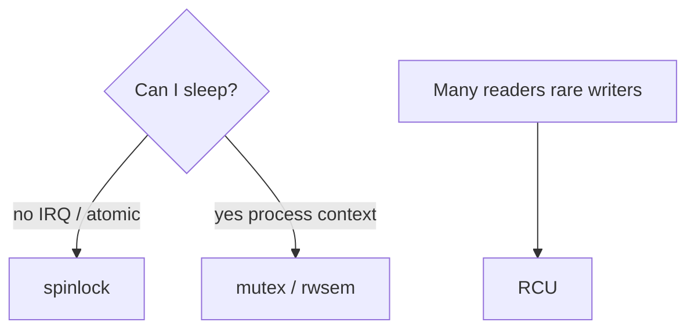
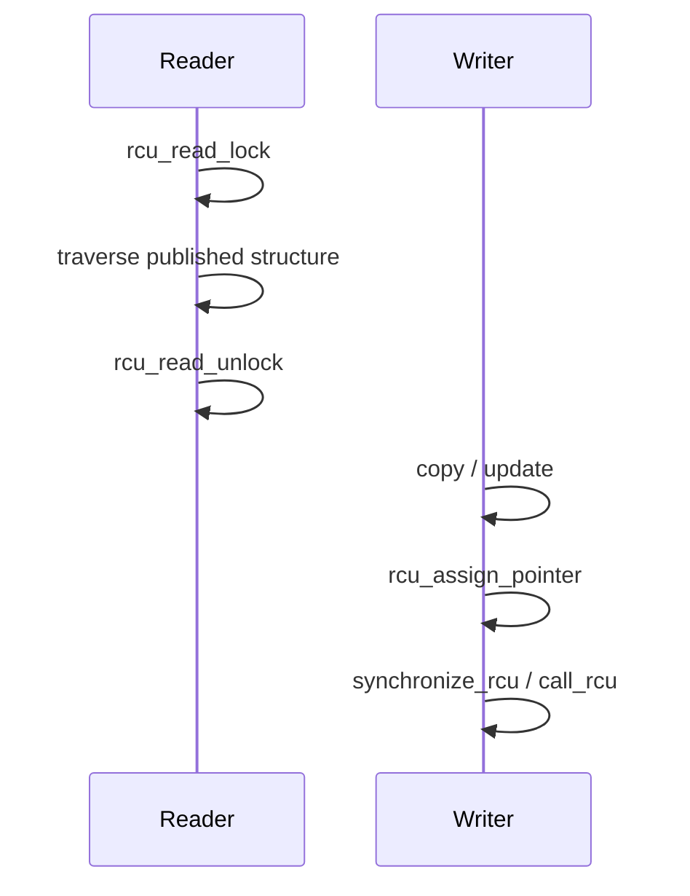

Concurrency is everywhere in the kernel. The wrong lock in the wrong context = deadlock or soft lockup.

## Quick chooser

## Mental notes

- **spinlock** — busy-wait; never sleep while holding
- **mutex** — can sleep; process context only
- **RCU** — readers run lock-free; writers publish carefully

## Keep reading

- [kernel.org — locking](https://docs.kernel.org/locking/)
- [kernel.org — RCU](https://docs.kernel.org/RCU/)
