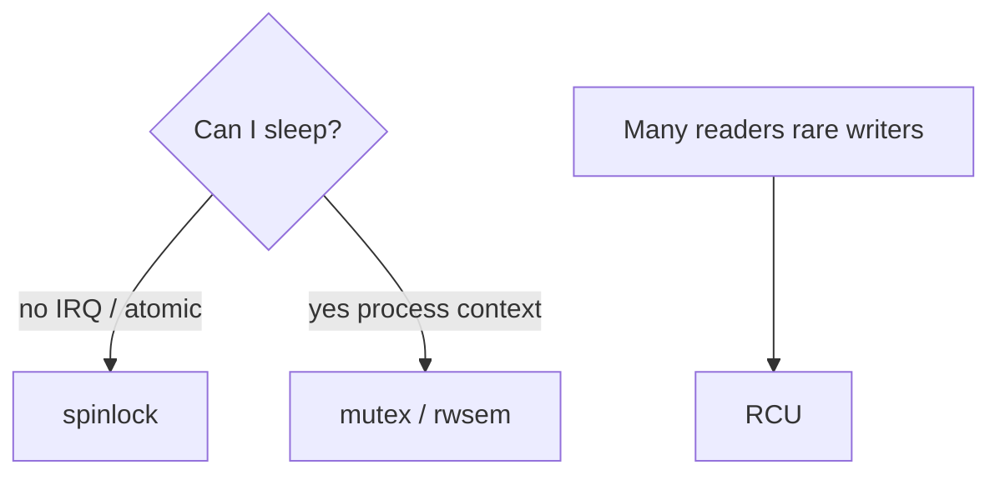
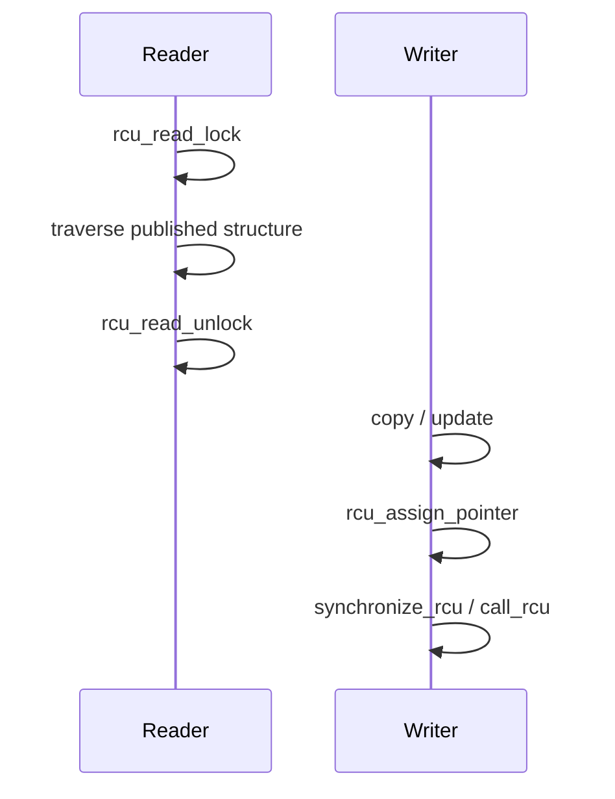

Concurrency is everywhere in the kernel: multiple CPUs, softirqs, workqueues, and syscalls sharing structures. The wrong lock in the wrong context means deadlock, soft lockup, or silent corruption.

## Quick chooser



Start from **context**, not from habit:

| Context | Typical tools |
| --- | --- |
| Hard IRQ / softirq / holding a spinlock already | spinlocks (or lockless designs) |
| Syscall / kthread that may block | mutex, rwsem, completions |
| Read-mostly linked structures | RCU (sometimes seqlocks) |
| Waiting for “someone else finished” | wait queues, completions |

## Spinlocks

A **spinlock** busy-waits until the lock is free. That is correct only when the holder runs for a **very short** time and **never sleeps**. Sleeping while holding a spinlock can deadlock the CPU that spins forever.

Variants you will see in code and lockdep reports:

- `spinlock_t` — ordinary
- `spin_lock_irqsave` — disables local interrupts (avoid IRQ re-entering the same lock)
- `spin_lock_bh` — disables softirqs on this CPU

Lockdep (when enabled) teaches ordering: if A→B on one path, never take B→A on another.

## Mutexes and sleepable locks

A **mutex** puts the waiter to sleep until the owner unlocks. That is friendlier under contention for long critical sections — but illegal in atomic context. **RW-semaphores** allow concurrent readers; writers still exclusive.

Also common:

- **completions** — “wait until this finished once”
- **wait_event** — sleep until a condition on a wait queue
- **semaphores** — counting; less fashionable in new code than mutexes/completions

## RCU in one page

**RCU** (Read-Copy-Update) lets readers walk data without taking a mutual-exclusion lock. Writers publish a new version, then wait for a **grace period** before freeing the old one — after every CPU has left its read-side critical section.



Mental rules:

- Readers use `rcu_read_lock` / `rcu_dereference`
- Writers publish with `rcu_assign_pointer`
- Freeing old data happens only after `synchronize_rcu` or via `call_rcu`

Deeper dive: [RCU grace periods](/linternals/blog/rcu-grace-periods/).

## In the kernel

These are three different kinds of function, not three wrappers around one lock.

**Spinlocks.** `kernel/locking/spinlock.c` defines `_raw_spin_lock`, `_raw_spin_lock_irq`, and `_raw_spin_lock_bh`. The headers turn `spin_lock()` into the raw function (or a lockdep-annotated wrapper). `_raw_spin_lock_irq` saves the interrupt flag and disables local IRQs for the hold. `_raw_spin_lock_bh` disables bottom halves so a softirq on this CPU cannot take the same lock. None of them call `schedule`.

**Mutexes.** `mutex_lock` in `kernel/locking/mutex.c` starts with `might_sleep()`. The fast path is `__mutex_trylock_fast`. If the owner is set, `__mutex_lock_slowpath` queues the task and sleeps. The comment above `mutex_lock` states the rules you can check in review: same task must unlock, no recursion, do not free the memory while it is locked. `CONFIG_DEBUG_MUTEXES` enforces that.

**RCU.** `rcu_read_lock` is an inline in `include/linux/rcupdate.h`. It calls `__rcu_read_lock()` and a lockdep acquire. The comment directly under it says `rcu_write_lock` does not exist: writers do not lock readers out. Writers exclude each other with a spinlock or mutex, publish with `rcu_assign_pointer`, then wait in `synchronize_rcu` (`kernel/rcu/tree.c` on the normal SMP build). That function warns if you call it from inside a read-side section. `call_rcu` schedules the free instead of waiting.

## Ordering and memory

Locks do double duty: **exclusion** and **memory ordering**. Unlocking guarantees other CPUs see prior writes once they take the same lock. Lockless algorithms need barriers / `READ_ONCE` / `WRITE_ONCE` / atomics — getting this wrong is architecture-dependent pain.

## Source landmarks

| Piece | Where |
| --- | --- |
| Spin | `kernel/locking/spinlock.c` — `_raw_spin_lock`, `_raw_spin_lock_irq` |
| Mutex | `kernel/locking/mutex.c` — `mutex_lock` |
| Read-side | `include/linux/rcupdate.h` — `rcu_read_lock` |
| Grace period | `kernel/rcu/tree.c` — `synchronize_rcu` |
| Lockdep | `kernel/locking/lockdep.c` |

## Lab — Contended locks in the wild (soft)

<div class="lab">

### Lab — Spot locking in traces / docs

```bash
# If lockdep / debug kernels are not available, at least confirm docs & symbols:
man 7 pthreads 2>/dev/null | head -5 || true
grep -E 'mutex_lock|spin_lock|_rcu' /proc/kallsyms 2>/dev/null | head -10 || echo "kallsyms restricted — normal on many distros"
```

**Expect:** either symbol lines hinting at the APIs, or a permission/lockdown message. On a debug kernel, lockdep splats in `dmesg` are the real teacher.

</div>

<div class="lab">

### Lab — Three functions, three files

**Goal:** See sleep, spin, and “no writer lock” in the source.

1. Open `kernel/locking/mutex.c` and find `mutex_lock`. The first call in the body is `might_sleep()`.
2. Open `kernel/locking/spinlock.c` and find `_raw_spin_lock_irq` and `_raw_spin_lock_bh`.
3. Open `include/linux/rcupdate.h` and find `rcu_read_lock`. Read the comment that says `rcu_write_lock` does not exist.

**Expect:** a mutex is allowed to sleep, a spinlock is not, and RCU has no writer-side counterpart of `rcu_read_lock`.

</div>

## Pitfalls

- **Sleep in atomic** — classic BUG; annotated by lockdep / might_sleep checks.
- **IRQ lock inversion** — taking a lock in IRQ that syscall paths take without disabling IRQ.
- **Over-broad locks** — one giant lock kills scalability; split or switch to RCU/refcounts.
- **Forgetting RCU free** — use-after-grace-period bugs are heisenbugs under load.

## Keep reading

- [RCU grace periods](/linternals/blog/rcu-grace-periods/)
- [Futexes: userspace to kernel](/linternals/blog/futexes-userspace-to-kernel/)
- [Workqueues and kthreads](/linternals/blog/workqueues-and-kthreads/)
- [Interrupts, softirqs, and bottom halves](/linternals/blog/interrupts-softirqs-and-tasklets/)
- [kernel.org — locking](https://docs.kernel.org/locking/)
- [kernel.org — RCU](https://docs.kernel.org/RCU/)
