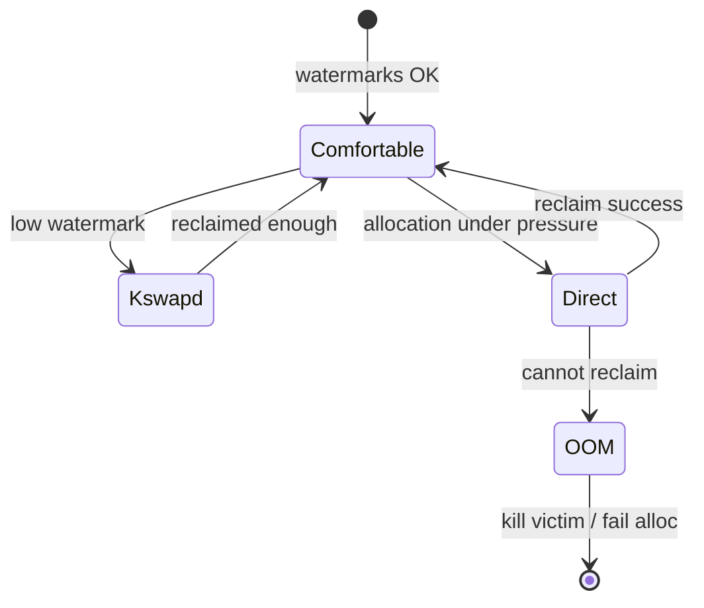
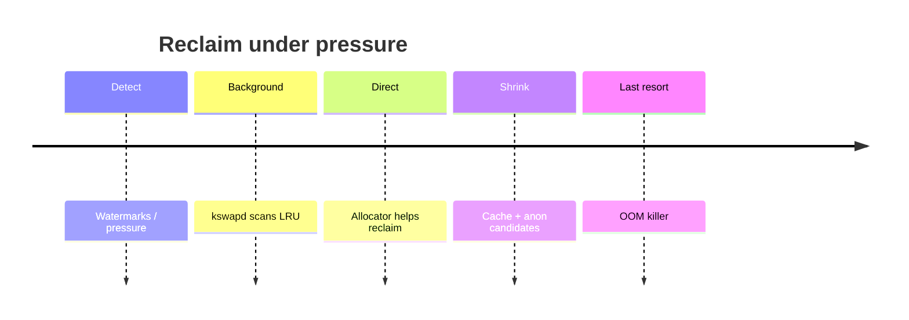

When free memory is low, Linux **reclaims** page cache and anonymous pages. If that fails under severe pressure, the **OOM killer** may sacrifice a process.

## Pressure path



## Stages (simplified)



## Ideas to keep straight

- **kswapd** — background reclaim per node.
- **Direct reclaim** — the allocating context helps free pages (can stall).
- **OOM** — pick a victim using heuristics (not “random”), then retry.

## Source landmarks

| Piece | Where |
| --- | --- |
| VM scan | `mm/vmscan.c` |
| OOM | `mm/oom_kill.c` |
| Watermarks | mm zone watermarks / docs |
| Docs | `Documentation/mm/` |

## Lab — Read pressure signals

<div class="lab">

### Lab — meminfo under load

1. Baseline:
   ```bash
   grep -E '^(MemTotal|MemAvailable|Cached|SwapTotal|SwapFree)' /proc/meminfo
   ```
2. Watch reclaim-ish counters (names vary slightly by kernel):
   ```bash
   grep -E 'pgsteal|pgscan|oom' /proc/vmstat | head
   ```
3. See OOM score for your shell (higher = more likely victim if OOM hits):
   ```bash
   cat /proc/$$/oom_score
   cat /proc/$$/oom_score_adj
   ```
**Expect:** sensible MemAvailable; `oom_score` nonzero; vmstat counters present (values depend on workload).

</div>

## Keep reading

- [Page cache and writeback](/linternals/blog/page-cache-and-writeback/)
- [Virtual memory walkthrough](/linternals/blog/virtual-memory-walkthrough/)
- [mmap and page faults (deep)](/linternals/blog/mmap-and-page-faults-deep/)
