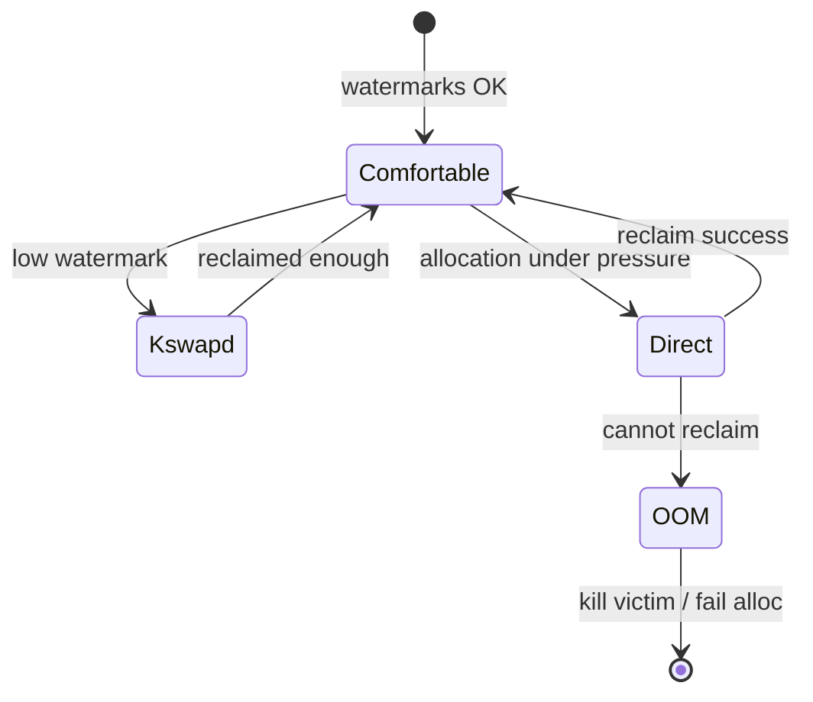
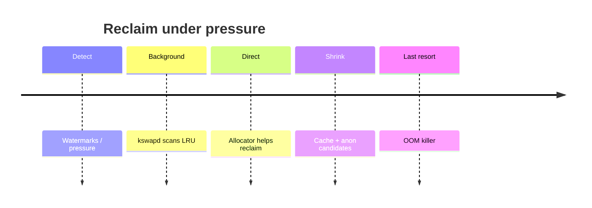

When free memory is low, Linux **reclaims** page cache and anonymous pages. If that fails under severe pressure, the **OOM killer** may sacrifice a process.

## Pressure path



## Stages (simplified)



## Ideas to keep straight

- **kswapd** — background reclaim per node.
- **Direct reclaim** — the allocating context helps free pages (can stall).
- **OOM** — pick a victim using heuristics (not “random”), then retry.

## In the kernel

When a zone sits below its low watermark, `wakeup_kswapd` in `mm/vmscan.c` wakes the per-node `kswapd` thread. That thread’s loop calls `balance_pgdat`, which repeatedly runs `shrink_node` over the node’s LRU lists until the watermarks look healthy or it decides to sleep again via `kswapd_try_to_sleep`.

If an allocation cannot wait for background reclaim, the page allocator calls `try_to_free_pages`. That builds a `scan_control`, may throttle the caller, then enters `do_try_to_free_pages`, which also walks zones through `shrink_node`. The allocating thread is doing the scan itself. That is direct reclaim, and it can stall for a long time.

When reclaim cannot free enough, the allocator reaches `out_of_memory` in `mm/oom_kill.c`. That function may short-circuit if the current task is already exiting, or if `oom_kill_allocating_task` is set. Otherwise it calls `select_bad_process`, which scores candidates with `oom_badness` (RSS, swap, and `oom_score_adj`), then `oom_kill_process` to send `SIGKILL` and queue the OOM reaper. After a kill, the allocator retries. A page-fault OOM that leaked out of the fault path hits `pagefault_out_of_memory`, which mostly synchronizes memcg OOM and retries rather than picking a global victim itself.

## Source landmarks

| Piece | Where |
| --- | --- |
| Wake / background | `mm/vmscan.c` — `wakeup_kswapd`, `kswapd`, `balance_pgdat` |
| Direct reclaim | `mm/vmscan.c` — `try_to_free_pages`, `do_try_to_free_pages`, `shrink_node` |
| OOM | `mm/oom_kill.c` — `out_of_memory`, `select_bad_process`, `oom_badness` |
| Kill | `mm/oom_kill.c` — `oom_kill_process` |

## Lab — Read pressure signals

<div class="lab">

### Lab — meminfo under load

1. Baseline:
   ```bash
   grep -E '^(MemTotal|MemAvailable|Cached|SwapTotal|SwapFree)' /proc/meminfo
   ```
2. Watch reclaim-ish counters (names vary slightly by kernel):
   ```bash
   grep -E 'pgsteal|pgscan|oom' /proc/vmstat | head
   ```
3. See OOM score for your shell (higher = more likely victim if OOM hits):
   ```bash
   cat /proc/$$/oom_score
   cat /proc/$$/oom_score_adj
   ```
**Expect:** sensible MemAvailable; `oom_score` nonzero; vmstat counters present (values depend on workload).

</div>

<div class="lab">

### Lab — Direct reclaim vs OOM

**Goal:** See that reclaim and kill are different files and functions.

1. Open `try_to_free_pages` in `mm/vmscan.c`. Follow it into `do_try_to_free_pages`.
2. Find `kswapd` in the same file and notice it calls `balance_pgdat`, not `try_to_free_pages`.
3. Open `out_of_memory` in `mm/oom_kill.c`. Find the call to `select_bad_process` and then `oom_kill_process`.

**Expect:** kswapd and the allocating thread share `shrink_node` ideas, but OOM only runs after reclaim has already failed.

</div>

## Keep reading

- [Page cache and writeback](/linternals/blog/page-cache-and-writeback/)
- [Virtual memory walkthrough](/linternals/blog/virtual-memory-walkthrough/)
- [mmap and page faults (deep)](/linternals/blog/mmap-and-page-faults-deep/)
