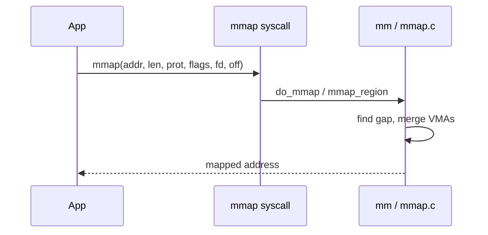
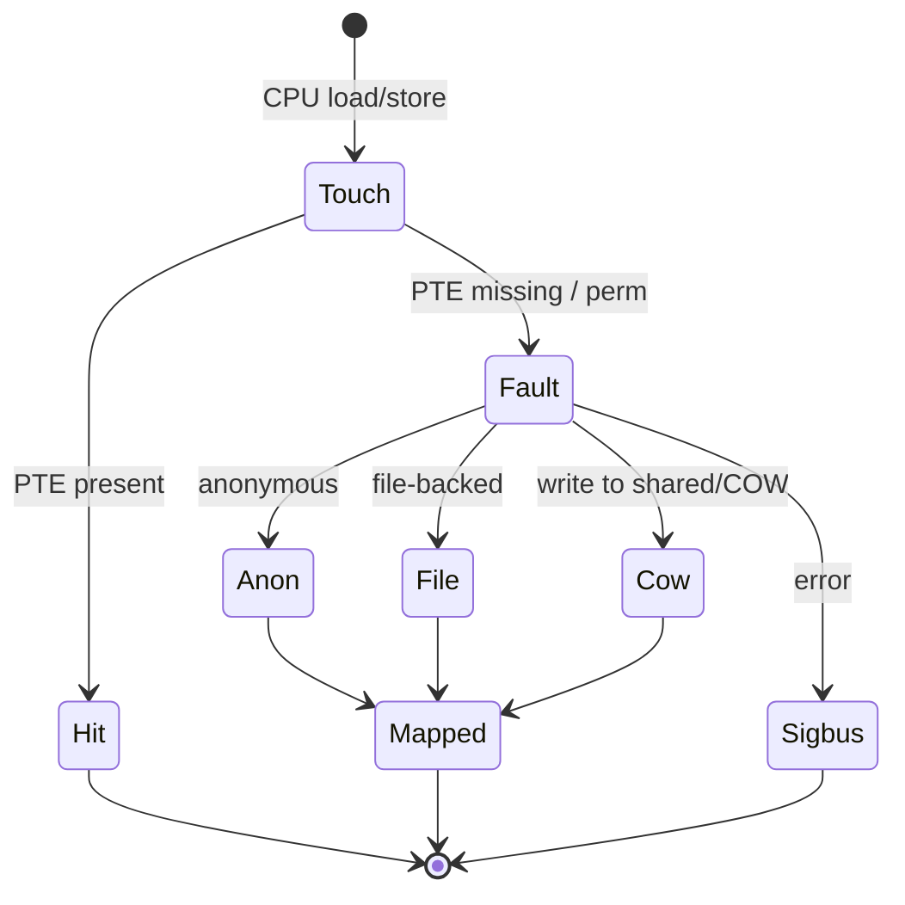

`read` copies into a buffer. **`mmap`** maps a file (or anonymous memory) into the address space so the CPU faults pages in on demand.

## Creating a mapping



Nothing guarantees the pages are resident yet — that comes on **first touch**.

## In the kernel

`mmap` enters `do_mmap` in `mm/mmap.c`. That function requires the mmap write lock (`mmap_assert_write_locked`), rejects a zero length, and aligns the length up with `PAGE_ALIGN`. It picks an address with `__get_unmapped_area`, then calls `mmap_region` to install the VMA. In current trees `mmap_region` lives in `mm/vma.c`; older trees keep it next to `do_mmap` in `mm/mmap.c`. It tries `vma_merge_new_range` with a neighbor and allocates a new VMA when that fails. No folio is allocated for the contents.

The first load or store misses in the page tables and reaches `handle_mm_fault` in `mm/memory.c`. A missing PTE is `do_pte_missing`. An anonymous VMA goes to `do_anonymous_page`, which allocates a zeroed folio and points a PTE at it. A file VMA goes to `do_fault`, and a normal file fault continues into `filemap_fault` so the page cache supplies the folio. A write to a page that is still shared after `fork` is `do_wp_page`: copy the folio, then point the writable PTE at the copy. A bad access returns a `VM_FAULT_SIGSEGV` or `VM_FAULT_SIGBUS` code; the architecture fault handler turns that into the signal.

So `mmap` is bookkeeping. The expensive and visible part is the fault, and it is shared with the page cache whenever the VMA is file-backed.

## Fault outcomes



## Source landmarks

| Piece | Where |
| --- | --- |
| Syscall body | `mm/mmap.c` — `do_mmap` |
| Install the VMA | `mmap_region` (called from `do_mmap`; `mm/vma.c` in current trees) |
| Missing PTE | `mm/memory.c` — `do_pte_missing`, `do_anonymous_page`, `do_wp_page` |
| File folio | `mm/filemap.c` — `filemap_fault` |

## Lab — Map a file and watch RSS

<div class="lab">

### Lab — Demand paging in `/proc`

1. Create a small file and map it with a one-liner (Python):
   ```bash
   dd if=/dev/zero of=/tmp/mm.bin bs=1M count=8 status=none
   python3 - <<'PY'
   import mmap, os, time
   f = open('/tmp/mm.bin','r+b')
   m = mmap.mmap(f.fileno(), 0)
   print('mapped', len(m), 'pid', os.getpid())
   time.sleep(30)  # inspect /proc/<pid>/smaps in another shell
   m.close(); f.close()
   PY
   ```
2. In another terminal, while it sleeps:
   ```bash
   # replace PID
   grep -A2 mm.bin /proc/<PID>/smaps | head
   ```
3. Touch pages (add `m[0]=1` before sleep in a second run) and compare Rss.

**Expect:** a VMA for `/tmp/mm.bin`; RSS grows after you dirty/read pages.

</div>

<div class="lab">

### Lab — mmap returns before any page exists

**Goal:** Separate the VMA install from the fault.

1. Open `mm/mmap.c` and find `do_mmap`. Find the call to `mmap_region`.
2. Open `mm/memory.c` and find `do_pte_missing`. One branch is `do_anonymous_page`; the other is `do_fault`.
3. Search `do_wp_page`. That is the copy, not the original mapping.

**Expect:** `do_mmap` does not call `do_anonymous_page`. The zero page shows up only after a fault on an anonymous VMA.

</div>

## Keep reading

- [Virtual memory walkthrough](/linternals/blog/virtual-memory-walkthrough/)
- [Page tables and the TLB](/linternals/blog/page-tables-and-tlb/)
- [userfaultfd and remote faults](/linternals/blog/userfaultfd-and-remote-faults/)
- [Page cache and writeback](/linternals/blog/page-cache-and-writeback/)
- [ELF loading and dynamic linking](/linternals/blog/elf-loading-and-dynamic-linking/)
