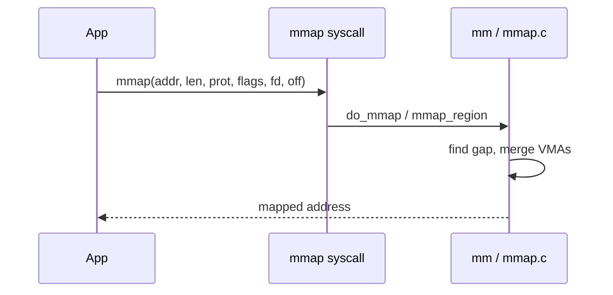
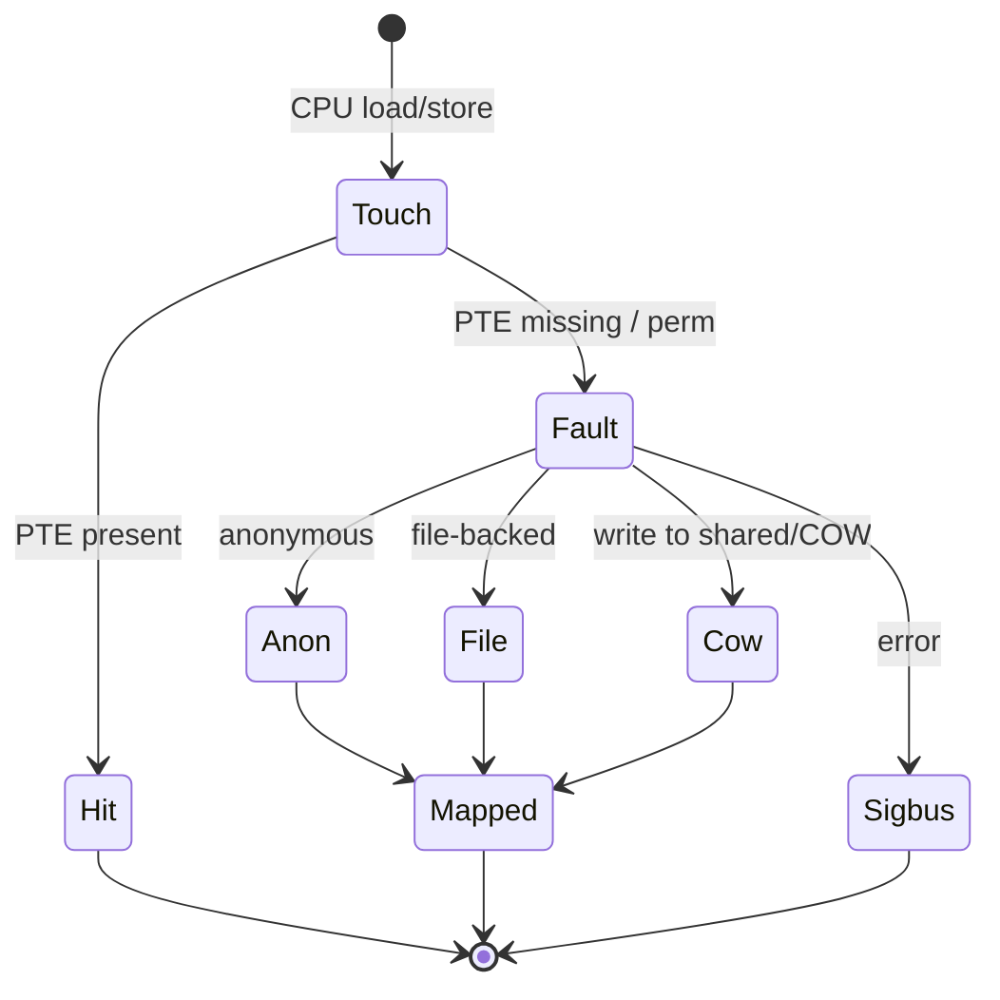

`read` copies into a buffer. **`mmap`** maps a file (or anonymous memory) into the address space so the CPU faults pages in on demand.

## Creating a mapping



Nothing guarantees the pages are resident yet — that comes on **first touch**.

## Fault outcomes



## Source landmarks

| Piece | Where |
| --- | --- |
| mmap | `mm/mmap.c` |
| fault | `mm/memory.c` (`handle_mm_fault`) |
| filemap fault | `mm/filemap.c` |
| VMA types | `include/linux/mm_types.h` |

## Lab — Map a file and watch RSS

<div class="lab">

### Lab — Demand paging in `/proc`

1. Create a small file and map it with a one-liner (Python):
   ```bash
   dd if=/dev/zero of=/tmp/mm.bin bs=1M count=8 status=none
   python3 - <<'PY'
   import mmap, os, time
   f = open('/tmp/mm.bin','r+b')
   m = mmap.mmap(f.fileno(), 0)
   print('mapped', len(m), 'pid', os.getpid())
   time.sleep(30)  # inspect /proc/<pid>/smaps in another shell
   m.close(); f.close()
   PY
   ```
2. In another terminal, while it sleeps:
   ```bash
   # replace PID
   grep -A2 mm.bin /proc/<PID>/smaps | head
   ```
3. Touch pages (add `m[0]=1` before sleep in a second run) and compare Rss.

**Expect:** a VMA for `/tmp/mm.bin`; RSS grows after you dirty/read pages.

</div>

## Keep reading

- [Virtual memory walkthrough](/linternals/blog/virtual-memory-walkthrough/)
- [Page tables and the TLB](/linternals/blog/page-tables-and-tlb/)
- [userfaultfd and remote faults](/linternals/blog/userfaultfd-and-remote-faults/)
- [Page cache and writeback](/linternals/blog/page-cache-and-writeback/)
- [ELF loading and dynamic linking](/linternals/blog/elf-loading-and-dynamic-linking/)
