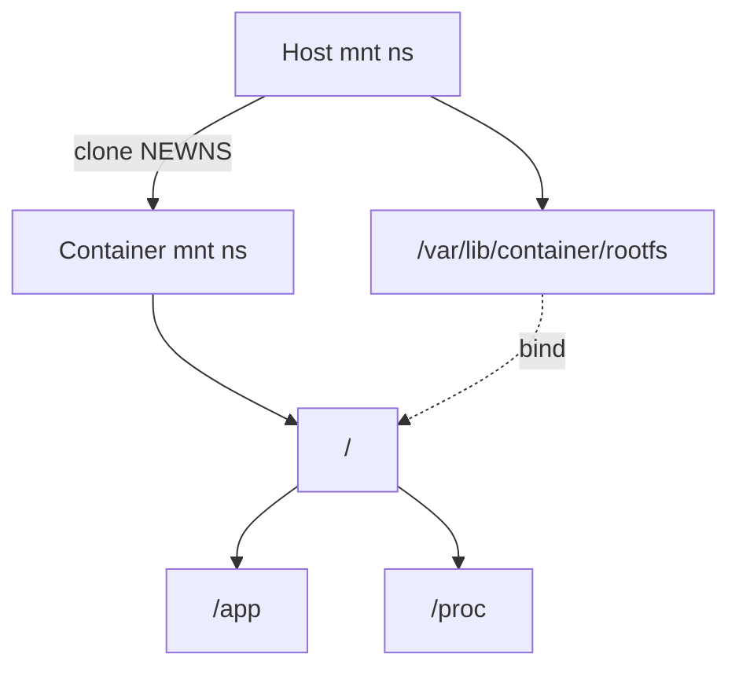
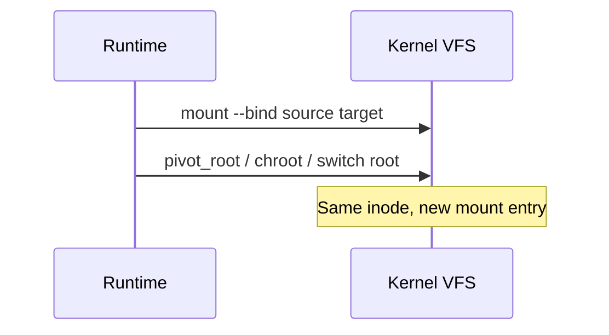

A **mount namespace** gives a process its own mount tree. Combined with **bind mounts**, runtimes assemble a rootfs without copying files.

## Views



## Bind mounts



| Flag / idea | Effect |
| --- | --- |
| `MS_BIND` | Attach existing tree elsewhere |
| `MS_REC` | Recursive bind |
| private / shared / slave | Propagation between namespaces |
| `pivot_root` | Swap roots cleanly for containers |

## Source landmarks

| Piece | Where |
| --- | --- |
| Mount ns | `fs/namespace.c` |
| Docs | `man 7 mount_namespaces` |
| Related | overlayfs, VFS dentries |

## Lab — See your mounts

<div class="lab">

### Lab — Read mountinfo

```bash
# Rich view of mounts for this process
head -20 /proc/$$/mountinfo
# Simpler:
findmnt | head -25
```

**Expect:** root and bind/overlay entries; paths differ inside containers vs on the host.

</div>

## Keep reading

- [Namespaces and cgroups](/linternals/blog/namespaces-and-cgroups/)
- [OverlayFS sketch](/linternals/blog/overlayfs-sketch/)
- [VFS and the open path](/linternals/blog/vfs-and-the-open-path/)
- [PID namespaces (deep)](/linternals/blog/pid-namespaces-deep/)
