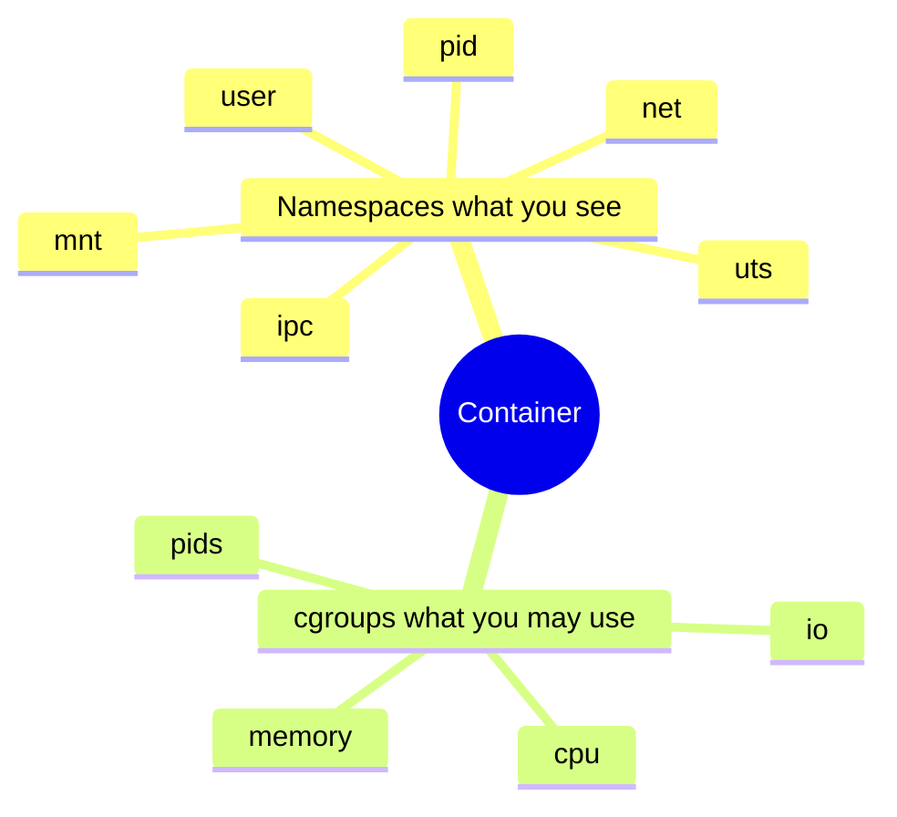

Docker/Podman feel magical until you see the two kernel features underneath: **namespaces** (what you see) and **cgroups** (what you may consume).

## Isolation vs limits



## Experiment

```bash
# Your PID namespace
ls -l /proc/$$/ns
# cgroup membership
cat /proc/$$/cgroup
```

## Source / docs

- `kernel/nsproxy.c`, `kernel/pid_namespace.c`
- [kernel.org — cgroup v2](https://docs.kernel.org/admin-guide/cgroup-v2.html)

## Keep reading

- [PID namespaces (deep)](/linternals/blog/pid-namespaces-deep/)
- [Mount namespaces and bind mounts](/linternals/blog/mount-namespaces-and-bind-mounts/)
- [cgroup v2 controllers](/linternals/blog/cgroup-v2-controllers/)
- [Capabilities and LSM intro](/linternals/blog/capabilities-and-lsm-intro/)
- [seccomp-BPF intro](/linternals/blog/seccomp-bpf-intro/)
- Related: [Anatomy of a Linux process](/linternals/blog/anatomy-of-a-linux-process/)
