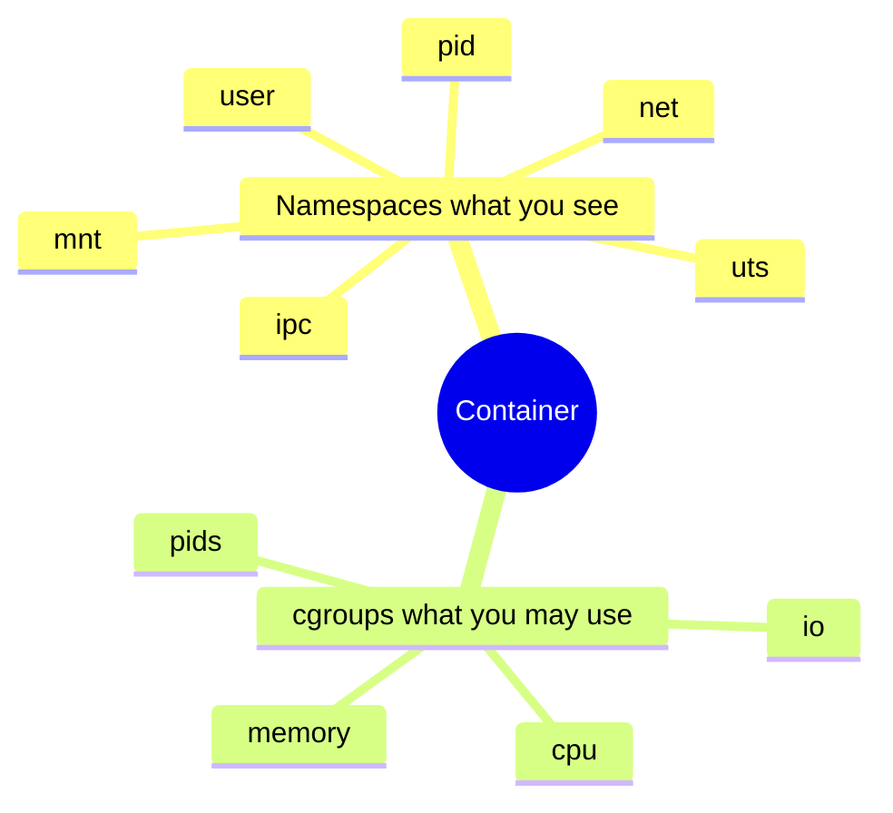

Docker/Podman feel magical until you see the two kernel features underneath: **namespaces** (what you see) and **cgroups** (what you may consume). A “container” is usually a process tree with new namespaces, a packed root filesystem, resource limits, and often tightened capabilities / seccomp / LSM labels — not a separate hypervisor VM.

## Isolation vs limits



Namespaces change **identity and visibility**. Cgroups change **quotas and accounting**. You can use either without the other (e.g. `chroot`+limits, or bare namespaces for testing).

## Namespace tour

| Namespace | Isolates | Everyday symptom |
| --- | --- | --- |
| **pid** | Process ID view | PID 1 inside ≠ host PID ([deep dive](/linternals/blog/pid-namespaces-deep/)) |
| **mnt** | Mount tree | Own `/`, bind mounts, overlay ([mounts](/linternals/blog/mount-namespaces-and-bind-mounts/)) |
| **net** | Interfaces, routes, sockets | veth + bridge wiring ([netns](/linternals/blog/netns-and-veth/)) |
| **uts** | Hostname / domain | `hostname` differs in container |
| **ipc** | System V IPC / POSIX mqueues | Separate message queues |
| **user** | UIDs / GIDs mapping | Root inside maps to unprivileged outside |
| **cgroup** | cgroup root view | Nested delegation |
| **time** | Monotonic / boottime offsets | ([time namespaces](/linternals/blog/time-namespaces/)) |

Each task points at a `nsproxy` (and related structs). `clone` / `unshare` / `setns` create or enter namespaces. `/proc/$$/ns/` shows inode identities — same inode means same namespace.

## Cgroups in one breath

**cgroup v2** is a unified hierarchy under `/sys/fs/cgroup`. Controllers like `cpu`, `memory`, `io`, `pids` expose files such as `memory.max` and `cpu.max`. The container runtime creates a cgroup, moves the container’s PIDs into `cgroup.procs`, and writes limits.

Details and a lab: [cgroup v2 controllers](/linternals/blog/cgroup-v2-controllers/). OOM interaction: [Memory reclaim and OOM](/linternals/blog/memory-reclaim-and-oom/).

## How a runtime builds a container (sketch)

1. Prepare rootfs (often OverlayFS layers).
2. `clone` with `CLONE_NEW*` flags (or equivalent via Go/Rust libraries).
3. Set up mounts (`proc`, `sys`, binds), pivot root.
4. Configure netns (veth, IP, routes).
5. Drop capabilities, install seccomp, apply LSM profile.
6. Enter cgroup with CPU/memory limits.
7. `exec` the entrypoint as PID 1 in the pid ns.

Security is layered: namespaces alone do not make a sandbox. See [Capabilities and LSM intro](/linternals/blog/capabilities-and-lsm-intro/) and [seccomp-BPF intro](/linternals/blog/seccomp-bpf-intro/).

## Source landmarks

| Piece | Where |
| --- | --- |
| nsproxy | `kernel/nsproxy.c` |
| pid ns | `kernel/pid_namespace.c` |
| cgroup core | `kernel/cgroup/` |
| Docs | `man 7 namespaces`, cgroup v2 admin guide |

## Lab — See your membership

<div class="lab">

### Lab — Namespaces and cgroup path

```bash
ls -l /proc/$$/ns
cat /proc/$$/cgroup
# Compare hostname vs host if you have a container handy
hostname
```

**Expect:** symlinks like `pid:[…]`, `mnt:[…]`; a cgroup path under controllers (v2 often shows `0::/…`). Inside a container, pid/mnt/net inodes differ from the host’s.

</div>

## Pitfalls

- **PID 1 duties** — reaping zombies; a naive entrypoint can accumulate zombies.
- **Leaky mounts / proc** — wrong flags expose host information.
- **user ns + devices** — not everything maps cleanly; privileged ops still fail.
- **Thinking cgroup = security** — limits stop resource abuse, not syscall escape on their own.

## Keep reading

- [System V IPC and POSIX message queues](/linternals/blog/ipc-sysv-and-mqueue/)
- [PID namespaces (deep)](/linternals/blog/pid-namespaces-deep/)
- [Mount namespaces and bind mounts](/linternals/blog/mount-namespaces-and-bind-mounts/)
- [Network namespaces and veth](/linternals/blog/netns-and-veth/)
- [Time namespaces](/linternals/blog/time-namespaces/)
- [cgroup v2 controllers](/linternals/blog/cgroup-v2-controllers/)
- [Capabilities and LSM intro](/linternals/blog/capabilities-and-lsm-intro/)
- [seccomp-BPF intro](/linternals/blog/seccomp-bpf-intro/)
- Related: [Anatomy of a Linux process](/linternals/blog/anatomy-of-a-linux-process/)
