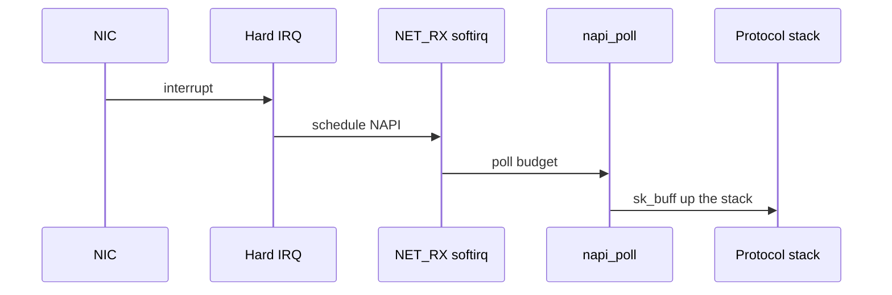

A packet-per-interrupt model melts under load. **NAPI** lets drivers **disable IRQ storms**, poll a budget of packets from softirq context, then re-enable interrupts when quiet.

## RX path sketch



## Pieces


| Concept | Role |
| --- | --- |
| `napi_struct` | Per-queue / per-device poll state |
| budget | Max work per poll slice |
| softnet | Per-CPU backlog / stats (`/proc/net/softnet_stat`) |
| GRO | Aggregate related segments before stack |

## Source landmarks

| Piece | Where |
| --- | --- |
| Core | `net/core/dev.c` |
| Softirq | `NET_RX_SOFTIRQ` path |
| Docs | `Documentation/networking/napi.rst` |

## Lab — softnet counters

<div class="lab">

### Lab — Read softnet_stat

```bash
# Columns: processed, dropped, time_squeeze, … (see docs)
cat /proc/net/softnet_stat | head -8
# Interface stats hint:
ip -s link | head -40
```

**Expect:** one line per CPU in `softnet_stat`; rising `time_squeeze` under heavy RX can mean poll budget exhaustion.

</div>

## Keep reading

- [Sockets and the networking stack](/linternals/blog/sockets-and-the-networking-stack/)
- [Interrupts, softirqs, and tasklets](/linternals/blog/interrupts-softirqs-and-tasklets/)
- [TCP state machine sketch](/linternals/blog/tcp-state-machine-sketch/)
