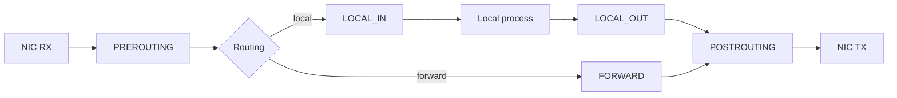

**Netfilter** is the kernel’s packet-filtering and mangling framework. Userspace tools (`iptables`, `nftables`) install rules; the datapath walks **hooks** as packets move through the stack.

## Hook points



## Mental model

| Hook | Typical use |
| --- | --- |
| PREROUTING | DNAT, early mangle |
| LOCAL_IN | Filter packets to local sockets |
| FORWARD | Filter routed traffic |
| LOCAL_OUT | Packets from local sockets |
| POSTROUTING | SNAT, final mangle |

Tables (filter, nat, mangle, …) are a userspace/nftables organizing idea; the kernel still evaluates registered hooks in order.

## Source landmarks

| Piece | Where |
| --- | --- |
| Core | `net/netfilter/` |
| IPv4 hooks | `net/ipv4/netfilter/` |
| nftables | `net/netfilter/nft_*.c` |
| Docs | `Documentation/networking/netfilter-*.rst` (tree varies) |

## Lab — See rules (read-only)

<div class="lab">

### Lab — List nft / iptables if present

```bash
# Prefer nftables when available (may need root)
sudo nft list ruleset 2>/dev/null | head -40 || echo "nft not available or no permission"
# Legacy view on some systems:
sudo iptables -L -n 2>/dev/null | head -30 || true
```

**Expect:** chains tied to INPUT/FORWARD/OUTPUT (or nft equivalents), or a permission error if unprivileged.

</div>

## Keep reading

- [Sockets and the networking stack](/linternals/blog/sockets-and-the-networking-stack/)
- [TCP state machine sketch](/linternals/blog/tcp-state-machine-sketch/)
- [Namespaces and cgroups](/linternals/blog/namespaces-and-cgroups/)
