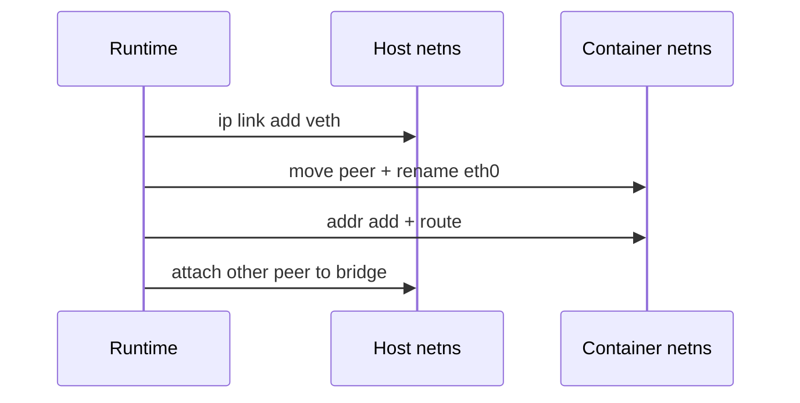

A **network namespace** owns its own interfaces, routes, and sockets. Runtimes usually create a **veth pair**: one end in the host (or bridge), one end in the container netns.

## Wiring




## What is isolated

| Object | Per netns? |
| --- | --- |
| Interfaces / addresses | Yes |
| Routing tables | Yes |
| Firewall hooks view | Yes (per-ns rules) |
| Physical NIC | Usually stays in host; shared via veth/bridge/macvlan |

## Source landmarks

| Piece | Where |
| --- | --- |
| netns | `net/core/net_namespace.c` |
| veth | `drivers/net/veth.c` |
| Docs | `man 8 ip-netns` |

## Lab — List namespaces

<div class="lab">

### Lab — ip netns / /var/run/netns

```bash
ip netns list 2>/dev/null || echo "no named netns (containers often use anonymous ns)"
ls /var/run/netns 2>/dev/null | head
# Your current ns inode:
readlink /proc/$$/ns/net
```

**Expect:** a netns inode symlink; named netns only if someone created them with `ip netns`.

</div>

## Keep reading

- [Namespaces and cgroups](/linternals/blog/namespaces-and-cgroups/)
- [Sockets and the networking stack](/linternals/blog/sockets-and-the-networking-stack/)
- [Netfilter hooks sketch](/linternals/blog/netfilter-and-hooks-sketch/)
