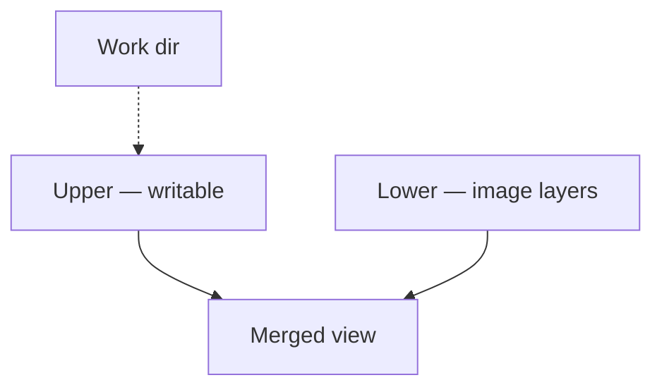
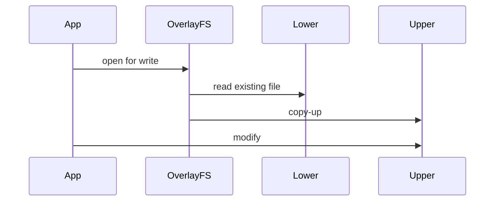

**OverlayFS** stacks a read-only **lower** tree under a writable **upper** layer. Container images are layers; the writable container root is usually an overlay.

## Layers



## Copy-up



| Piece | Role |
| --- | --- |
| lowerdir | Read-only base (may be multi-layer) |
| upperdir | Writes and new files |
| workdir | Internal opaque work area |
| whiteout | Marks deleted lower files |

## Source landmarks

| Piece | Where |
| --- | --- |
| Core | `fs/overlayfs/` |
| Docs | `Documentation/filesystems/overlayfs.rst` |
| Related | [Mount namespaces and bind mounts](/linternals/blog/mount-namespaces-and-bind-mounts/) |

## Lab — Spot overlays

<div class="lab">

### Lab — findmnt overlay

```bash
findmnt -t overlay 2>/dev/null | head -20 || echo "no overlay mounts visible"
grep overlay /proc/$$/mountinfo | head -10 || true
```

**Expect:** overlay lines inside containers; often none on a bare desktop session.

</div>

## Keep reading

- [Mount namespaces and bind mounts](/linternals/blog/mount-namespaces-and-bind-mounts/)
- [VFS and the open path](/linternals/blog/vfs-and-the-open-path/)
- [ext4 on-disk sketch](/linternals/blog/ext4-on-disk-sketch/)
