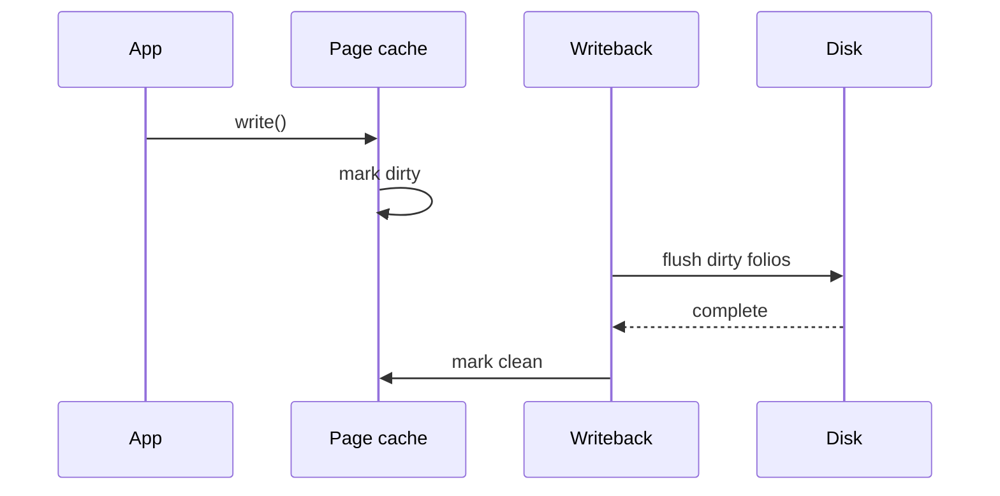

File I/O rarely hits disk on every `read`/`write`. The **page cache** (folios in modern kernels) holds file contents in RAM; **writeback** pushes dirty pages to storage later.

## Big picture


## Read path (simplified)

1. VFS resolves the inode / mapping.
2. Find or allocate a folio in the address_space page cache.
3. On miss: filesystem fills the folio from disk (often via the block layer).
4. Copy data to userspace (or map it for `mmap`).

## Write path (simplified)

1. Data lands in cache; pages marked **dirty**.
2. Background flusher threads / balance_dirty_pages decide when to writeback.
3. Filesystem turns dirty ranges into bios; storage completes; pages clean again.

## In the kernel

The cache is an `address_space` hanging off the inode (`i_mapping` / `file->f_mapping`). A folio is the object stored there, indexed by file offset. `read` on a normal file ends in `filemap_read` in `mm/filemap.c`. It looks at `filp->f_mapping`, batches folios that cover the requested range, and copies them to the iterator. A hole in the cache is filled by `filemap_read_folio`, which calls the filesystem’s filler. That filler builds bios; the page cache does not know the on-disk layout.

`write` of a cached file ends in `generic_perform_write`, also in `mm/filemap.c`. Each chunk starts with `balance_dirty_pages_ratelimited`. That wrapper lives in `mm/page-writeback.c` and, when the caller is dirtying memory faster than writeback can drain it, calls `balance_dirty_pages` and sleeps the writer. Then the filesystem’s `write_begin` gets or creates the folio, the copy lands in it, and `write_end` marks it dirty. The bytes are not on disk yet. The flusher work lives in `fs/fs-writeback.c`: it takes dirty folios, asks the filesystem to turn them into bios, and the completion path marks them clean.

`mmap` of a file shares this cache. A fault in that VMA calls `filemap_fault`, which finds or reads the same folio `read` would have used. There is one copy of the file page, whether you `read` it or fault it.



## Source landmarks

| Idea | Where |
| --- | --- |
| Read | `mm/filemap.c` — `filemap_read`, `filemap_read_folio` |
| Write | `mm/filemap.c` — `generic_perform_write` |
| Throttle | `mm/page-writeback.c` — `balance_dirty_pages_ratelimited` |
| Flusher | `fs/fs-writeback.c` |
| Fault | `mm/filemap.c` — `filemap_fault` |

## Lab — Watch cache pressure

<div class="lab">

### Lab — Dirty pages and reclaim clues

**Goal:** See the kernel’s view of cached / dirty memory.

1. Snapshot memory overview:
   ```bash
   grep -E '^(MemTotal|MemFree|Cached|Dirty|Writeback)' /proc/meminfo
   ```
2. Generate some file cache (safe in `/tmp`):
   ```bash
   dd if=/dev/zero of=/tmp/linternals-cache.bin bs=1M count=64 status=none
   grep -E '^(Cached|Dirty)' /proc/meminfo
   ```
3. Drop caches if you have root and want a before/after (optional):
   ```bash
   sync
   # sudo sh -c 'echo 3 > /proc/sys/vm/drop_caches'   # careful on shared machines
   ```
**Expect:** `Cached` rises after the `dd`; `Dirty` may spike briefly then fall after writeback.

</div>

## Keep reading

- [Virtual memory walkthrough](/linternals/blog/virtual-memory-walkthrough/)
- [Block layer and bio](/linternals/blog/block-layer-and-bio/)
- [splice and sendfile](/linternals/blog/splice-and-sendfile/)
- [Memory reclaim and OOM](/linternals/blog/memory-reclaim-and-oom/)
- [VFS and the open path](/linternals/blog/vfs-and-the-open-path/)
- [kernel.org — mm](https://docs.kernel.org/mm/index.html)
