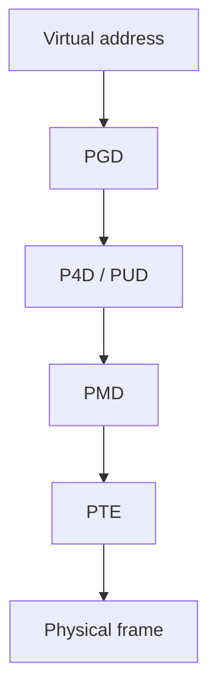
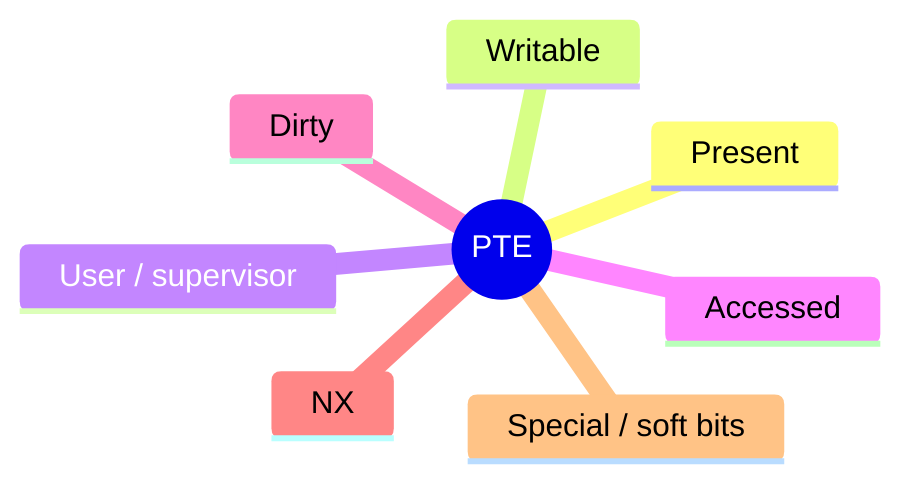

Virtual addresses are fiction until the MMU **walks page tables**. Linux builds a multi-level tree per `mm_struct`; the hardware caches translations in the **TLB**.

## Walk (x86-64 style)



Levels and names shift by arch and config (`P4D` may be folded). The idea is the same: **index each level**, eventually get a PTE with a PFN + flags.

## PTE flags (mental set)



Fault handlers interpret missing or protected PTEs — see [mmap and page faults (deep)](/linternals/blog/mmap-and-page-faults-deep/).

## TLB

| Event | Typical action |
| --- | --- |
| PTE change (unmap, protect) | Flush TLB entries for that VA / mm |
| Context switch | Often ASID/PCID or flush strategy |
| Shootdown | IPIs so other CPUs drop stale entries |

Stale TLB entries are correctness bugs. That is why unmap and mprotect paths carefully order **page table updates** and **flushes**.

## In the kernel

A `mm_struct` owns the top of the tree (`pgd`). The hardware walk is a chain of offsets: `pgd_offset`, then `p4d_offset`, `pud_offset`, `pmd_offset`, and finally a PTE. A folded level is still named; the offset function just returns the parent pointer. A leaf at PMD or PUD is a huge page, so the walk stops early.

Software does the same walk when it must change a translation. On x86, `lookup_address` in `arch/x86/mm/pat/set_memory.c` starts at `pgd_offset_k` and returns the PTE that covers a kernel virtual address, plus which level it found. That is a kernel mapping walk, not a user fault. User misses go through `handle_mm_fault` in `mm/memory.c`, which allocates the missing levels and installs a PTE.

The TLB is not updated by writing the PTE. After an unmap or `mprotect`, the kernel must invalidate. On x86 the range flush is `flush_tlb_mm_range` in `arch/x86/mm/tlb.c`. If another CPU still has this `mm` loaded, that function calls `flush_tlb_multi` on `mm_cpumask`; otherwise it flushes only the local TLB. Unmap batches those flushes through an `mmu_gather` in `mm/mmu_gather.c` and then calls the architecture flush. A context switch often avoids a full flush by tagging entries with an ASID or PCID so the next process does not reuse the previous translations.

## Source landmarks

| Piece | Where |
| --- | --- |
| Offsets | `pgd_offset`, `p4d_offset`, `pud_offset`, `pmd_offset` |
| Kernel walk | `arch/x86/mm/pat/set_memory.c` — `lookup_address` |
| User install | `mm/memory.c` — `handle_mm_fault` |
| x86 flush | `arch/x86/mm/tlb.c` — `flush_tlb_mm_range` |
| Batched unmap | `mm/mmu_gather.c` |

## Lab — Maps and TLB-ish cost

<div class="lab">

### Lab — Watch your own maps

```bash
# Mappings for the current shell
cat /proc/$$/maps | head -20
# Huge vs base pages (hinting only)
grep -E 'AnonHugePages|KernelPageSize' /proc/$$/smaps | head -10
```

**Expect:** text/heap/stack/vdso regions in `maps`; smaps counters that hint at page sizes / hugepages.

</div>

<div class="lab">

### Lab — Find one level of the walk

**Goal:** See that a page-table walk is a chain of offset helpers, not one function named “walk”.

1. In a kernel tree, search for `lookup_address`. On x86 it should call `pgd_offset_k`.
2. Open that function’s callee and notice it checks a level at a time (`p4d`, `pud`, `pmd`) and can stop on a leaf.
3. Search `flush_tlb_mm_range`. That is the invalidate, separate from the store that changed the PTE.

**Expect:** changing a PTE and dropping the TLB entry are two steps. The first lives with the page tables; the second is architecture flush code.

</div>

## Keep reading

- [Virtual memory walkthrough](/linternals/blog/virtual-memory-walkthrough/)
- [mmap and page faults (deep)](/linternals/blog/mmap-and-page-faults-deep/)
- [Hugepages and THP](/linternals/blog/hugepages-and-thp/)
- [Slab allocator and kmalloc](/linternals/blog/slab-allocator-and-kmalloc/)
