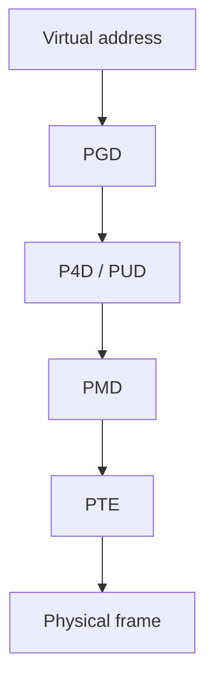
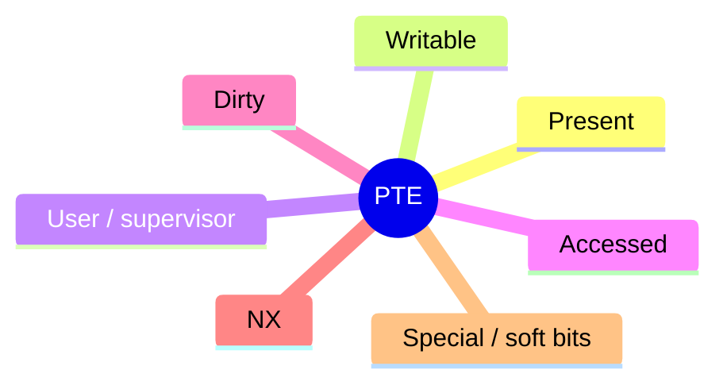

Virtual addresses are fiction until the MMU **walks page tables**. Linux builds a multi-level tree per `mm_struct`; the hardware caches translations in the **TLB**.

## Walk (x86-64 style)



Levels and names shift by arch and config (`P4D` may be folded). The idea is the same: **index each level**, eventually get a PTE with a PFN + flags.

## PTE flags (mental set)



Fault handlers interpret missing or protected PTEs — see [mmap and page faults (deep)](/linternals/blog/mmap-and-page-faults-deep/).

## TLB

| Event | Typical action |
| --- | --- |
| PTE change (unmap, protect) | Flush TLB entries for that VA / mm |
| Context switch | Often ASID/PCID or flush strategy |
| Shootdown | IPIs so other CPUs drop stale entries |

Stale TLB entries are correctness bugs. That is why unmap and mprotect paths carefully order **page table updates** and **flushes**.

## Source landmarks

| Piece | Where |
| --- | --- |
| Generic MM | `mm/memory.c`, `mm/mmap.c` |
| x86 | `arch/x86/mm/` |
| TLB | `mm/tlb.c`, arch TLB helpers |
| Docs | `Documentation/mm/` |

## Lab — Maps and TLB-ish cost

<div class="lab">

### Lab — Watch your own maps

```bash
# Mappings for the current shell
cat /proc/$$/maps | head -20
# Huge vs base pages (hinting only)
grep -E 'AnonHugePages|KernelPageSize' /proc/$$/smaps | head -10
```

**Expect:** text/heap/stack/vdso regions in `maps`; smaps counters that hint at page sizes / hugepages.

</div>

## Keep reading

- [Virtual memory walkthrough](/linternals/blog/virtual-memory-walkthrough/)
- [mmap and page faults (deep)](/linternals/blog/mmap-and-page-faults-deep/)
- [Slab allocator and kmalloc](/linternals/blog/slab-allocator-and-kmalloc/)
