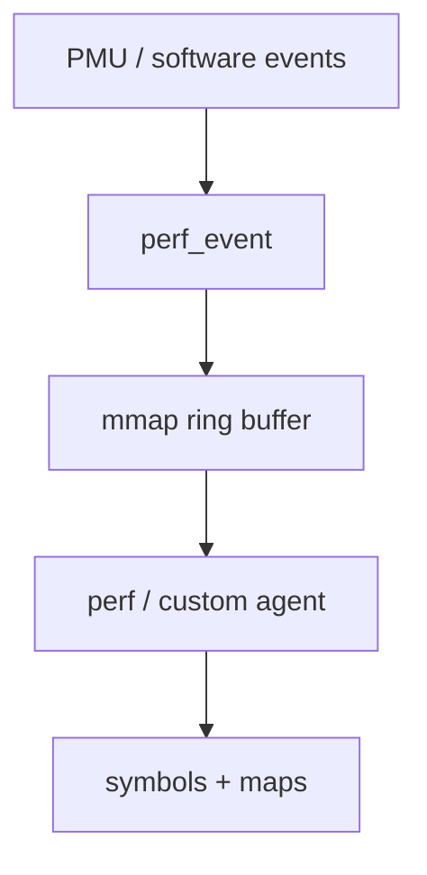
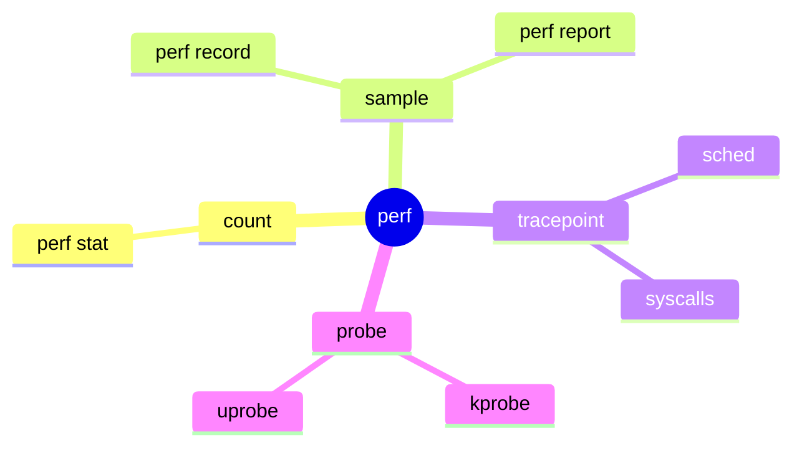

**perf** is the Swiss army knife for CPU and software events. Underneath, **`perf_event_open`** configures counters; tools sample stacks or count cache misses, migrations, and more.

## Model



## Common modes



| Tooling | Use |
| --- | --- |
| `perf stat` | Aggregate counters for a command |
| `perf record` / `report` | Hot functions |
| `perf script` | Raw samples for custom analysis |
| BPF | Often paired for richer context |

## Source landmarks

| Piece | Where |
| --- | --- |
| Core | `kernel/events/` |
| UAPI | `include/uapi/linux/perf_event.h` |
| Docs | `tools/perf/Documentation/` |

## Lab — One-shot stat

<div class="lab">

### Lab — `perf stat` a workload

```bash
# May need permissions / kernel.perf_event_paranoid tweak
perf stat -e cycles,instructions,cache-misses -- sleep 0.2 2>&1 | tail -20
```

**Expect:** a small counter table, or a clear permission error pointing at `perf_event_paranoid`.

</div>

## Keep reading

- [BPF and tracing intro](/linternals/blog/bpf-and-tracing-intro/)
- [kprobes and ftrace](/linternals/blog/kprobes-and-ftrace/)
- [procfs and observability](/linternals/blog/procfs-and-observability/)
- [Reading an oops](/linternals/blog/reading-an-oops/)
