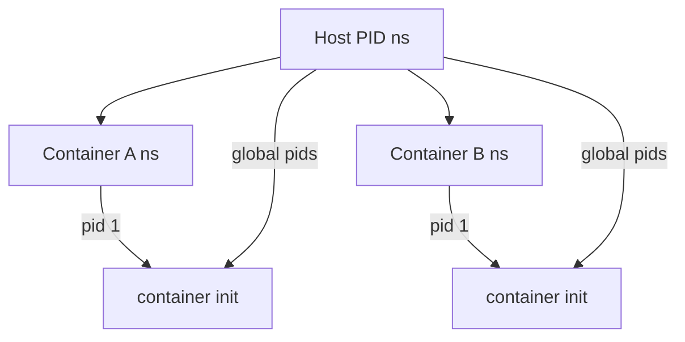
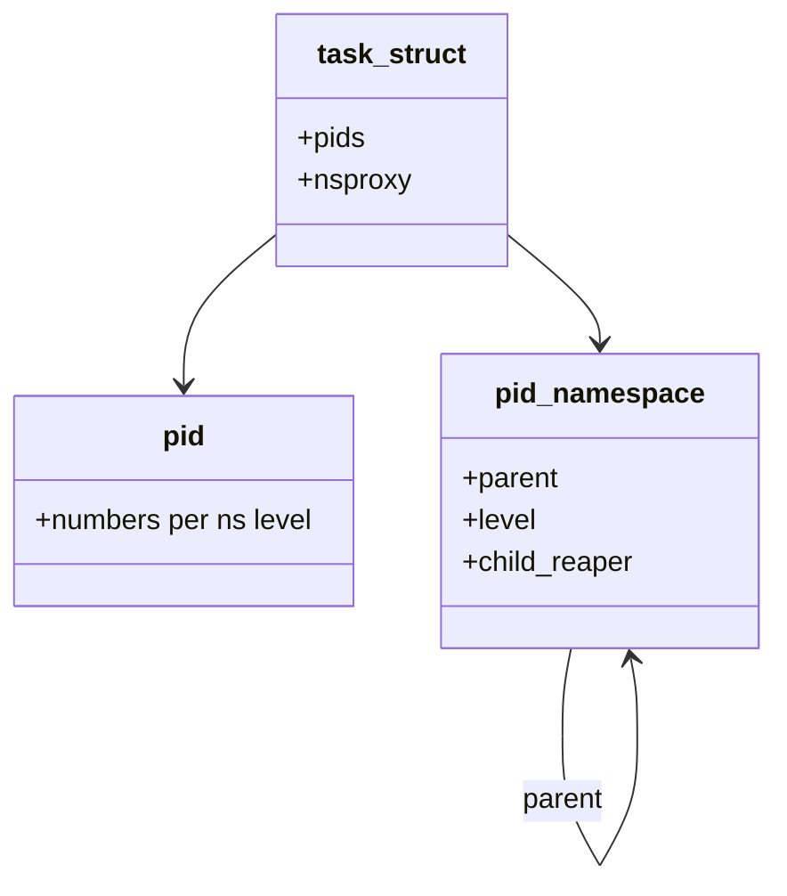

A **PID namespace** gives a process tree its own PID numbers. The same task can be PID 1 *inside* and a large number *outside* — containers depend on that translation.

## Nested views



## What the kernel tracks



- **`pid_nr_ns()`** — number for a given namespace.
- **Child reaper** — the namespace’s “init” adopts orphans; if it dies, the kernel may kill the namespace.
- **`CLONE_NEWPID`** — only the creating task becomes PID 1 in the new ns (usual container setup uses helpers).

## Signals and visibility

| Action | Effect |
| --- | --- |
| `kill` from inside | Targets PIDs in *that* ns |
| Host `kill` | Uses host PID (from `ps` / `/proc`) |
| `/proc` | Filtered by mount + pid ns view |

## Source landmarks

| Piece | Where |
| --- | --- |
| Core | `kernel/pid.c`, `kernel/pid_namespace.c` |
| Clone flags | `include/uapi/linux/sched.h` |
| Docs | `man 7 pid_namespaces` |

## Lab — See your PID from two views

<div class="lab">

### Lab — Nested PID (if unshare allowed)

```bash
# On a machine where unprivileged user ns + pid ns work:
unshare --user --map-root-user --pid --fork --mount-proc bash -c 'echo inside_pid=$$; ps -o pid,comm | head'
# From another host shell, find the same task with a different PID:
ps -ef | head
```

**Expect:** inside, shell is often PID 1 (or small); on the host, a different PID refers to the same task.

</div>

## Keep reading

- [Namespaces and cgroups](/linternals/blog/namespaces-and-cgroups/)
- [cgroup v2 controllers](/linternals/blog/cgroup-v2-controllers/)
- [Anatomy of a Linux process](/linternals/blog/anatomy-of-a-linux-process/)
- [Capabilities and LSM intro](/linternals/blog/capabilities-and-lsm-intro/)
