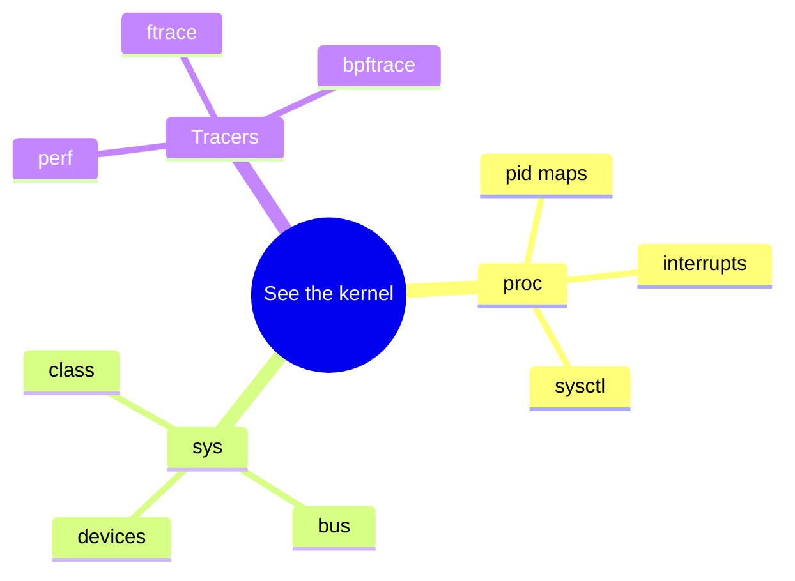

Before you dive into source, learn to **ask the running kernel** questions. `/proc`, `/sys`, `sysctl`, and the tracing stack turn opaque behavior into files and counters you can `cat`, `grep`, and script.

## Map of interfaces



## procfs — kernel and per-process views

`/proc` is a virtual filesystem. Two big zones matter daily:

**Global**

| Path | What you learn |
| --- | --- |
| `/proc/cpuinfo` | CPUs, features, siblings |
| `/proc/meminfo` | Memory accounting headline numbers |
| `/proc/interrupts` / `/proc/softirqs` | IRQ load per CPU |
| `/proc/net/*` | Sockets, SNMP-ish counters, routes |
| `/proc/sys/` | Live tunables (sysctl) |

**Per process** (`/proc/<pid>/` — `self` for “me”)

| Path | What you learn |
| --- | --- |
| `cmdline`, `status`, `comm` | Identity and state |
| `maps` / `smaps` | Virtual memory layout / RSS detail |
| `fd/` | Open file descriptors |
| `stack` | Kernel stack (when permitted) |
| `ns/` | Namespace inodes |
| `cgroup` | cgroup membership |

Permissions matter: many fields for other users’ PIDs are masked; containers see a filtered world.

## sysfs — devices and drivers

`/sys` exports the **device model**: buses, classes, block/net devices, module parameters. Prefer it over scraping `dmesg` when you want stable attributes (`mtu`, `address`, power state, driver binding).

Rule of thumb: **policy and devices → `/sys`**; **task and kernel summary → `/proc`**. Overlap exists (`/proc/sys` vs some sysfs knobs) — check docs when unsure.

## sysctl

`sysctl -a` reads `/proc/sys`. Classic knobs: `vm.swappiness`, `net.ipv4.ip_forward`, `kernel.panic`. Changes can be ephemeral (until reboot) or persisted by distro config under `/etc/sysctl.d/`. Wrong values here cause “mystery” production issues — treat writes with respect.

## Tracers when files are not enough

When you need *why* latency spiked or *who* called `schedule`:

- **perf** — counters and samples ([perf events intro](/linternals/blog/perf-events-intro/))
- **ftrace / tracefs** — function graphs, events ([kprobes and ftrace](/linternals/blog/kprobes-and-ftrace/))
- **BPF** — programmable, production-friendly ([BPF and tracing intro](/linternals/blog/bpf-and-tracing-intro/))

These still often *start* from a `/proc` or `/sys` clue (high softirq CPU → dig into NAPI; weird `MemAvailable` → reclaim).

## Source landmarks

| Piece | Where |
| --- | --- |
| procfs | `fs/proc/` |
| sysfs | `fs/sysfs/`, `drivers/base/` |
| sysctl | `kernel/sysctl.c` |

## Lab — Everyday commands

<div class="lab">

### Lab — Ask three questions

```bash
cat /proc/cpuinfo | head
ls /sys/class/net
# Tracing availability (may need root / debugfs)
ls /sys/kernel/tracing 2>/dev/null | head || ls /sys/kernel/debug/tracing 2>/dev/null | head || echo "tracefs not visible"
# Your own address space:
head -15 /proc/$$/maps
```

**Expect:** CPU feature lines; interface names under `net`; tracefs entries or a clear permission miss; maps showing text/heap/stack/vdso.

</div>

## Pitfalls

- **Parsing unstable formats** — prefer documented APIs (`ip`, `ss`, `findmnt`) for scripts; `/proc` text can evolve.
- **Container view ≠ host view** — PIDs, mounts, and `/proc` filters differ inside a pod.
- **Debugfs / tracefs** — often unmounted or root-only; absence is not “kernel lacks tracing.”
- **Cost** — high-frequency `cat` of huge proc files or enabling heavy tracers changes the system you observe.

## Keep reading

- [BPF and tracing intro](/linternals/blog/bpf-and-tracing-intro/)
- [perf events intro](/linternals/blog/perf-events-intro/)
- [kprobes and ftrace](/linternals/blog/kprobes-and-ftrace/)
- [Reading an oops](/linternals/blog/reading-an-oops/)
- [kernel.org — ftrace](https://docs.kernel.org/trace/ftrace.html)
- Related: [Reading kernel source](/linternals/blog/reading-kernel-source/)
