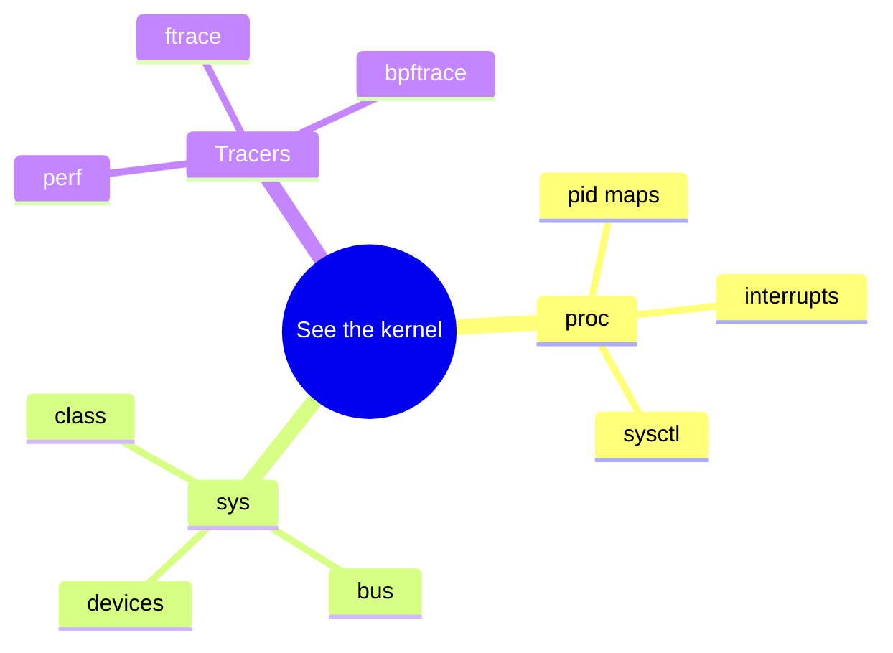

Before you read source, learn to **ask the running kernel** questions through `/proc`, `/sys`, and tracers.

## Map of interfaces



## Everyday commands

```bash
cat /proc/cpuinfo | head
ls /sys/class/net
sudo cat /sys/kernel/debug/tracing/available_tracers 2>/dev/null | head
```

## Keep reading

- [BPF and tracing intro](/linternals/blog/bpf-and-tracing-intro/)
- [kernel.org — ftrace](https://docs.kernel.org/trace/ftrace.html)
- Related: [Reading kernel source](/linternals/blog/reading-kernel-source/)
