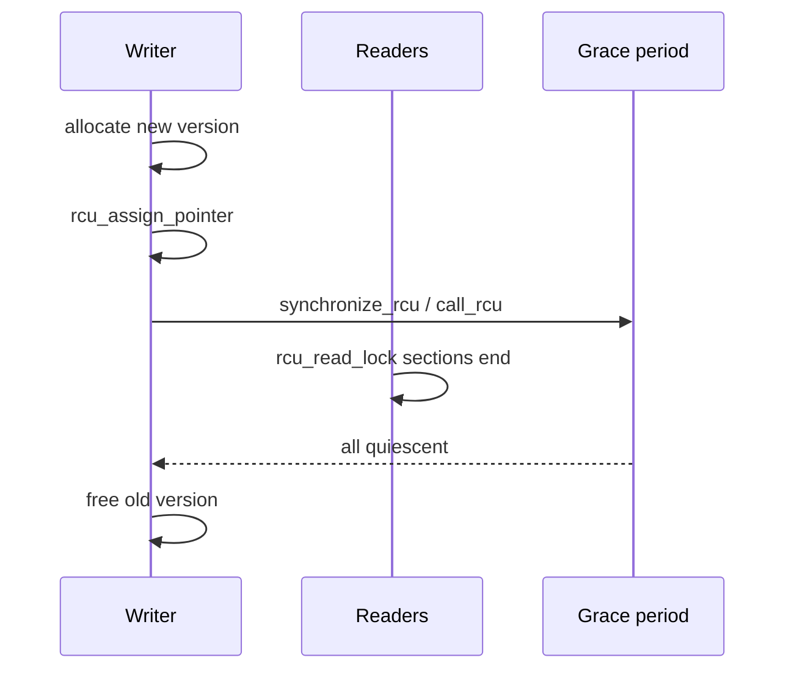
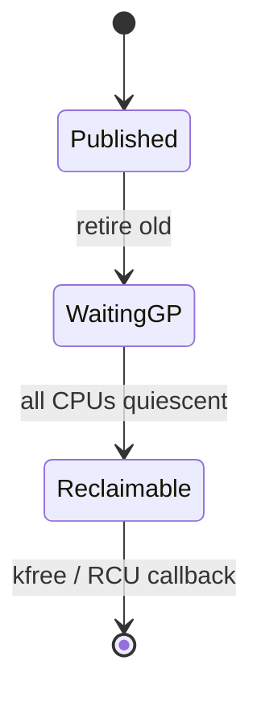

**RCU** lets readers walk data without locks. Writers publish new versions, then wait for a **grace period** before freeing the old one — after every CPU has left its read-side critical section.

## Publish / reclaim



## Mental model



| API | Role |
| --- | --- |
| `rcu_read_lock/unlock` | Mark read-side section |
| `rcu_dereference` | Safe load under RCU |
| `rcu_assign_pointer` | Publish with barriers |
| `synchronize_rcu` | Wait for grace period |
| `call_rcu` | Free asynchronously after GP |

Preemptible RCU, SRCU, and variants change the rules — start with classic “readers never block writers’ publish, writers delay free.”

## Source landmarks

| Piece | Where |
| --- | --- |
| Core | `kernel/rcu/` |
| Docs | `Documentation/RCU/` |
| Related | [Locks: spinlocks, mutexes, RCU](/linternals/blog/locks-spinlocks-mutexes-rcu/) |

## Lab — RCU in traces (optional)

<div class="lab">

### Lab — Spot RCU symbols

```bash
# If kernel debug symbols / kallsyms readable:
grep -E 'synchronize_rcu|call_rcu|rcu_read' /proc/kallsyms 2>/dev/null | head -15 || echo "kallsyms restricted"
```

**Expect:** many RCU symbols on a typical kernel, or empty output when kallsyms is locked down.

</div>

## Keep reading

- [Locks: spinlocks, mutexes, RCU](/linternals/blog/locks-spinlocks-mutexes-rcu/)
- [Workqueues and kthreads](/linternals/blog/workqueues-and-kthreads/)
- [Futexes: userspace to kernel](/linternals/blog/futexes-userspace-to-kernel/)
