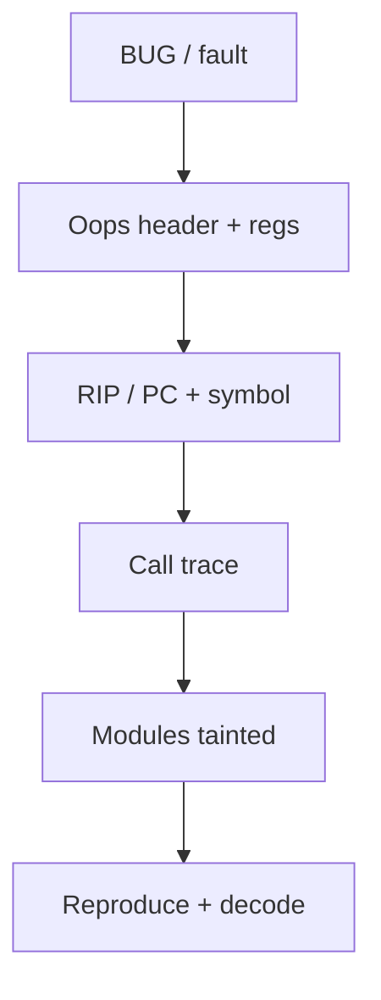
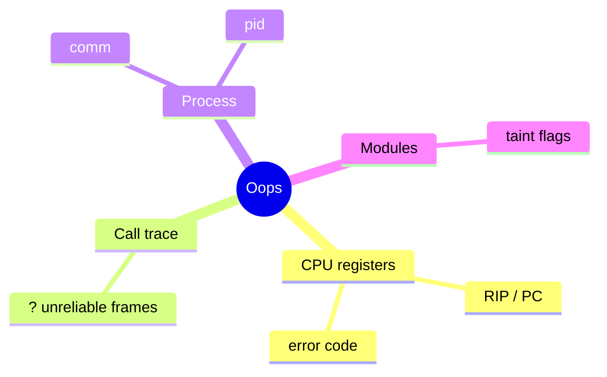

When the kernel hits a bug, it prints an **oops** (or panics). The splat looks noisy; a few fields tell you **where**, **what**, and **which module** to blame first.

## Anatomy



## Fields that matter



| Piece | Why |
| --- | --- |
| RIP + symbol | Faulting instruction / function |
| Call trace | How you got there |
| `Comm` / `PID` | Which task (or CPU softirq) |
| Taint / modules | Out-of-tree suspects |
| Code bytes | Disassemble around fault |

Use `scripts/decode_stacktrace.sh` or `llvm-addr2line` / `gdb` with **matching vmlinux** when addresses are raw.

## Source landmarks

| Piece | Where |
| --- | --- |
| Dump | `kernel/panic.c`, arch fault handlers |
| Decode | `scripts/decode_stacktrace.sh` |
| Docs | `Documentation/admin-guide/bug-hunting.rst` |

## Lab — Practice on a saved log

<div class="lab">

### Lab — Scan dmesg for oops markers

```bash
# Look for historical oops markers (may be empty on a healthy box)
dmesg -T 2>/dev/null | grep -E 'Oops:|BUG:|Call Trace:|RIP:' | tail -20 || true
journalctl -k -b 2>/dev/null | grep -E 'Oops:|BUG:' | tail -10 || true
```

**Expect:** often nothing on a clean system; when present, start at `RIP:` and the first non-`?` frames.

</div>

## Keep reading

- [Reading kernel source](/linternals/blog/reading-kernel-source/)
- [Kernel modules and the device model](/linternals/blog/kernel-modules-and-device-model/)
- [BPF and tracing intro](/linternals/blog/bpf-and-tracing-intro/)
