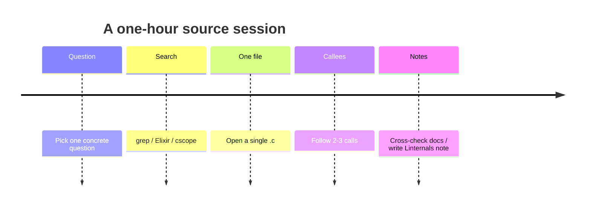
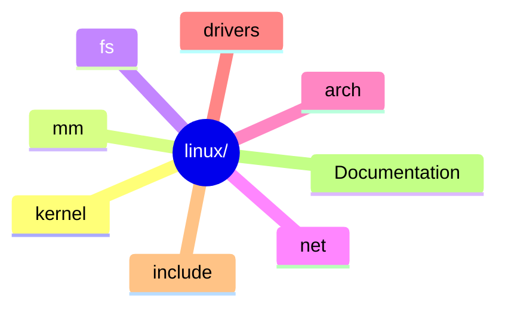

The Linux kernel is huge. You do not “read it”; you **navigate** it with a question in mind. This note is a starter map.

## Orient yourself

Good first questions:

- What happens on `openat`?
- Who wakes a sleeping task?
- What runs between `start_kernel` and PID 1?

## Top-level tree (abbreviated)

| Directory | Role |
| --- | --- |
| `kernel/` | Core: sched, time, signal, locking helpers |
| `mm/` | Memory management |
| `fs/` | VFS and many filesystems |
| `net/` | Networking stack |
| `arch/` | Architecture-specific code |
| `drivers/` | Device drivers (largest by volume) |
| `include/` | Shared headers |
| `Documentation/` | In-tree docs (also published on docs.kernel.org) |

## Tools that help

- **Elixir / bootlin** — browse tagged trees in the browser
- **`rg` / cscope / clangd** — local jump-to-definition
- **LWN.net** — explanations of why code changed
- **`scripts/`** — checkpatch and other helpers if you contribute later

## A one-hour exercise

1. Clone or browse a recent stable tag.
2. Search for `SYSCALL_DEFINE3(read` (or your arch’s equivalent).
3. Skim until you hit VFS (`vfs_read` territory).
4. Write five bullet notes: entry, locks, data structures, error paths, return.

## Keep reading

- [Reading an oops](/linternals/blog/reading-an-oops/)
- [https://elixir.bootlin.com/linux/latest/source](https://elixir.bootlin.com/linux/latest/source)
- [https://docs.kernel.org/](https://docs.kernel.org/)
- Back to: [Learning paths](/linternals/paths/)
