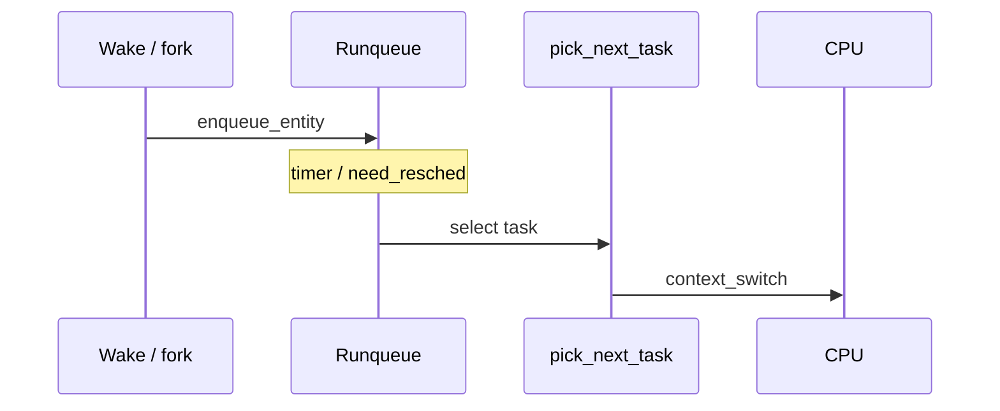
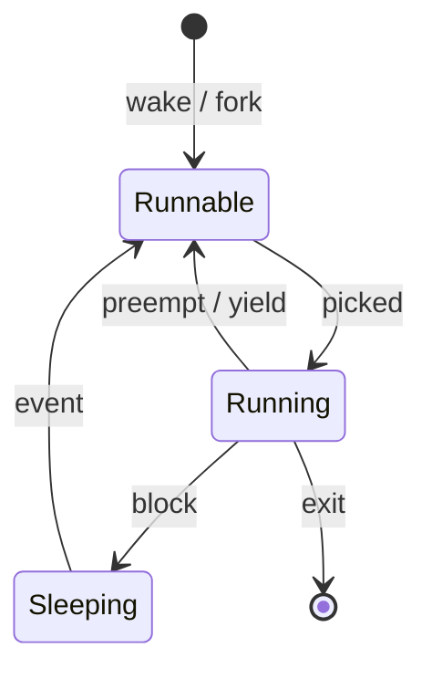

The scheduler decides which runnable `task_struct` owns the CPU. Classic **CFS** tracked virtual runtime; recent kernels move toward **EEVDF** (Earliest Eligible Virtual Deadline First) while keeping the same “be fair over time” goal.

## Placement in the kernel



## Task states the scheduler cares about



## CFS intuition

- Each task has a **vruntime** (virtual runtime) that advances slower for nice’d tasks.
- The leftmost node in the rbtree is “most owed” CPU time.
- `pick_next_entity` chooses that task (with heuristics / slices).

## EEVDF intuition

EEVDF still cares about fairness, but eligibility and **virtual deadlines** refine who may run when — reducing some latency edge cases of pure vruntime picking. Treat CFS docs as historical base; read current `kernel/sched/fair.c` comments for the live rules.

## Source landmarks

| Piece | Location |
| --- | --- |
| Fair class | `kernel/sched/fair.c` |
| Core schedule | `kernel/sched/core.c` |
| Task se | `struct sched_entity` in sched headers |
| Docs | `Documentation/scheduler/` |

## Lab — See the scheduler’s opinion

<div class="lab">

### Lab — Nice, policy, and run state

**Goal:** Observe how priority and state show up from userspace.

1. Check your shell’s scheduling fields:
   ```bash
   ps -o pid,ni,pri,psr,stat,comm -p $$
   cat /proc/$$/sched | head -20
   ```
2. Start a short CPU burner in the background and renice it (optional):
   ```bash
   (yes > /dev/null &) ; sleep 1
   # pgrep -n yes | xargs -I{} ps -o pid,ni,stat,comm -p {}
   # killall yes   # clean up
   ```
3. List CPU affinity / runqueue pressure lightly:
   ```bash
   grep -E 'procs_running|procs_blocked' /proc/stat
   ```
**Expect:** `STAT` with `R` or `S`, a nice value, and `procs_running` ≥ 1 when something is busy.

</div>

## Keep reading

- [Anatomy of a Linux process](/linternals/blog/anatomy-of-a-linux-process/)
- [kernel.org — scheduler](https://docs.kernel.org/scheduler/)
