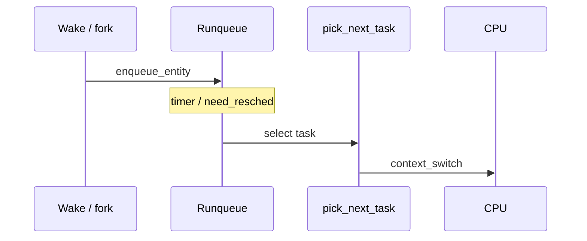
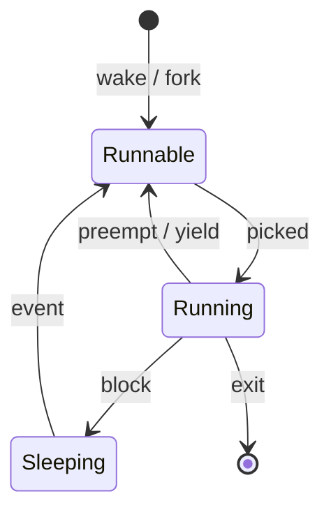

The scheduler decides which runnable `task_struct` owns the CPU. Classic **CFS** tracked virtual runtime; recent kernels move toward **EEVDF** (Earliest Eligible Virtual Deadline First) while keeping the same “be fair over time” goal.

## Placement in the kernel



## Task states the scheduler cares about



## CFS intuition

- Each task has a **vruntime** (virtual runtime) that advances slower for higher-weight tasks.
- The runqueue keeps entities ordered so the one owed the most time can be found quickly.
- Sleeping does not advance vruntime, so a wake-up is owed a turn.

## In the kernel

The fair class is `kernel/sched/fair.c`. `pick_task_fair` is what the core scheduler calls for this class. It starts at `rq->cfs` and, while the chosen entity is a task group, descends. Before each pick it calls `update_curr` if the current entity is still on the queue.

`update_curr` measures how long that entity just ran and adds `calc_delta_fair(...)` to `vruntime`. Weight is inside that delta: a nicer task’s vruntime moves faster, so it reaches the back of the line sooner. The comment in `update_curr` is worth reading once: `cfs_rq->curr` is the entity the fair class picked, which is not always `rq->curr` when proxy execution is involved.

The actual choice is `pick_next_entity`, and that function’s first real call is `pick_eevdf`. A `cfs_rq` with one runnable entity returns it and skips the search. Otherwise `pick_eevdf` takes the leftmost entity when it is eligible, because the tree orders earlier virtual deadlines to the left. If that node is not eligible, the walk continues for the earliest deadline that is. vruntime still moves. Eligibility and the deadline are what decide the next task.

`kernel/sched/core.c` is the class-independent part: it asks the fair class for a task and `context_switch`es to it. Policy, the runqueue lock, and the switch live there. vruntime and the deadline live in `fair.c`.

## Source landmarks

| Piece | Where |
| --- | --- |
| Pick | `kernel/sched/fair.c` — `pick_task_fair`, `pick_next_entity`, `pick_eevdf` |
| Clock | `kernel/sched/fair.c` — `update_curr`, `calc_delta_fair` |
| Switch | `kernel/sched/core.c` — `context_switch` |
| Entity | `struct sched_entity` |

## Lab — See the scheduler’s opinion

<div class="lab">

### Lab — Nice, policy, and run state

**Goal:** Observe how priority and state show up from userspace.

1. Check your shell’s scheduling fields:
   ```bash
   ps -o pid,ni,pri,psr,stat,comm -p $$
   cat /proc/$$/sched | head -20
   ```
2. Start a short CPU burner in the background and renice it (optional):
   ```bash
   (yes > /dev/null &) ; sleep 1
   # pgrep -n yes | xargs -I{} ps -o pid,ni,stat,comm -p {}
   # killall yes   # clean up
   ```
3. List CPU affinity / runqueue pressure lightly:
   ```bash
   grep -E 'procs_running|procs_blocked' /proc/stat
   ```
**Expect:** `STAT` with `R` or `S`, a nice value, and `procs_running` ≥ 1 when something is busy.

</div>

<div class="lab">

### Lab — vruntime is not the picker

**Goal:** See the clock and the EEVDF pick as two functions.

1. Open `kernel/sched/fair.c` and find `update_curr`. Confirm it adds `calc_delta_fair` into `vruntime`.
2. Find `pick_next_entity`. Its pick call should be `pick_eevdf`, not a raw leftmost-node load.
3. Find `pick_task_fair` and the loop that calls `update_curr` before `pick_next_entity`.

**Expect:** vruntime still moves on every tick of CPU time. The task that runs next is chosen by `pick_eevdf`.

</div>

## Keep reading

- [Anatomy of a Linux process](/linternals/blog/anatomy-of-a-linux-process/)
- [SMP and CPU affinity](/linternals/blog/smp-and-cpu-affinity/)
- [kernel.org — scheduler](https://docs.kernel.org/scheduler/)
